# PROJECT DEEP ANALYSIS: AI-PENTEST COPILOT (v5.0)

> **Tài liệu phân tích kỹ thuật chuyên sâu toàn diện mã nguồn hệ thống AI-Pentest Copilot**  
> **Tác giả phân tích:** Senior Software Architect + Codebase Analyst + Reverse Engineer  
> **Dự án:** AI-Pentest Copilot (v5.0 — Dynamic Target + Integrated Pentest Toolset)  
> **Tiêu chuẩn kiểm chứng:** 100% đối soát mã nguồn thực tế (FACT / VERIFIED / PARTIALLY VERIFIED / UNKNOWN)  
> **Tệp mục tiêu tạo duy nhất:** `PROJECT_DEEP_ANALYSIS.md`

---

## Mục Lục Tổng Quan (Table of Contents)

1. [1. Project Overview](#1-project-overview)
2. [2. Complete Project Tree](#2-complete-project-tree)
3. [3. File Inventory](#3-file-inventory)
4. [4. Detailed File Analysis](#4-detailed-file-analysis)
5. [5. Import Dependency Graph](#5-import-dependency-graph)
6. [6. Function / Method Call Graph](#6-function--method-call-graph)
7. [7. API Architecture](#7-api-architecture)
8. [8. Frontend Architecture](#8-frontend-architecture)
9. [9. Backend Architecture](#9-backend-architecture)
10. [10. AI / Agent Architecture](#10-ai--agent-architecture)
11. [11. Knowledge / RAG Architecture](#11-knowledge--rag-architecture)
12. [12. Database Architecture](#12-database-architecture)
13. [13. End-to-End Data Flow](#13-end-to-end-data-flow)
14. [14. Chat Execution Flow](#14-chat-execution-flow)
15. [15. Security / Guardrails Architecture](#15-security--guardrails-architecture)
16. [16. Configuration Architecture](#16-configuration-architecture)
17. [17. Infrastructure](#17-infrastructure)
18. [18. Application Startup Flow](#18-application-startup-flow)
19. [19. Test Architecture](#19-test-architecture)
20. [20. Potentially Unused / Dead Code](#20-potentially-unused--dead-code)
21. [21. Circular Dependencies](#21-circular-dependencies)
22. [22. Critical Files](#22-critical-files)
23. [23. Change Impact Map](#23-change-impact-map)
24. [24. Complete System Architecture](#24-complete-system-architecture)
25. [25. File Relationship Matrix](#25-file-relationship-matrix)
26. [26. Real Execution Scenarios](#26-real-execution-scenarios)
27. [27. First 60 Seconds of the Application](#27-first-60-seconds-of-the-application)
28. [28. Debugging Guide](#28-debugging-guide)
29. [29. Extension Guide](#29-extension-guide)
30. [30. Architecture Risks](#30-architecture-risks)
31. [31. Final Knowledge Map](#31-final-knowledge-map)
32. [32. If You Only Read 20 Files](#32-if-you-only-read-20-files)

---

## 1. Project Overview

### 1.1 Mục Đích & Bản Chất Của Dự Án
**AI-Pentest Copilot** là một nền tảng bàn làm việc an ninh toàn diện (**Full-Stack Security Workbench**) kết hợp trợ lý trí tuệ nhân tạo tương tác theo thời gian thực (**AI Copilot / IDE Chat**), cơ sở dữ liệu tri thức lỗ hổng ngoại tuyến (**Authoritative Vulnerability Knowledge Base**) và cơ chế điều phối chuỗi công cụ trinh sát/kiểm thử an ninh tiêu chuẩn (**Reconnaissance Orchestration Engine**).

Dự án được định vị theo nguyên lý:
- **Phòng thủ và hỗ trợ con người (Defense-oriented, Human-in-the-loop)**: Tuyệt đối không tự động hóa việc tấn công khai thác phá hoại (automated exploitation) hay thả mã độc/reverse shell.
- **Tiếp nhận mục tiêu động (Zero-Friction Dynamic Target Ingestion)**: Cho phép nhập trực tiếp IP, CIDR, URL, Host:Port hoặc Domain mà không cần soạn thảo file cấu hình YAML tĩnh.
- **Tính toán toàn vẹn chứng cứ số (Forensic Integrity)**: Lưu trữ dữ liệu quét thô bất biến (Raw XML, JSONL, TXT) kèm nhật ký kiểm toán câu lệnh thực thi (`commands.md`).
- **Chống ảo giác (Anti-Hallucination Guardrails)**: Cấm sinh ra số hiệu CVE/CWE, điểm CVSS hoặc URL hư cấu; phân tầng phát ngôn thành `FACT`, `INFERENCE`, và `HYPOTHESIS`.

### 1.2 Bảng Tổng Hợp Công Nghệ Sử Dụng (Technology Stack)

| Thành Phần | Công Nghệ / Thư Viện Thực Tế | Bằng Chứng Mã Nguồn (Evidence) |
|---|---|---|
| **Ngôn ngữ Backend** | Python 3.10+ (Hỗ trợ Python 3.14) | `run.py`, `backend/requirements.txt` |
| **Framework Backend** | FastAPI, Uvicorn, Starlette, Pydantic v2, Pydantic-Settings | `backend/app/main.py:L7`, `config.py:L7` |
| **Giao tiếp Realtime** | WebSockets (RFC 6455) qua FastAPI WebSocket endpoints | `backend/app/ws/chat.py:L18`, `backend/app/api/terminal.py:L370` |
| **Cơ sở dữ liệu** | SQLite 3 (`toolkit/data/kb.sqlite`), kết nối trực tiếp qua thư viện chuẩn `sqlite3` | `backend/app/storage/db.py:L22` |
| **Ngôn ngữ Frontend** | TypeScript 5.2, JavaScript ES2022 | `frontend/tsconfig.json`, `package.json` |
| **Framework Frontend** | React 18.2, Vite 5.2 | `frontend/package.json` |
| **State Management** | Zustand 4.5 | `frontend/src/store/workspaceStore.ts:L1` |
| **Styling & UI** | Tailwind CSS 3.4, Lucide React (Icons), Canvas API | `frontend/tailwind.config.js`, `frontend/src/index.css` |
| **Trình soạn thảo mã** | Monaco Editor (`@monaco-editor/react` 4.6) | `frontend/src/components/Editor/MainPanel.tsx` |
| **Trình giả lập Terminal** | xterm.js (`@xterm/xterm` 5.5, `@xterm/addon-fit`) | `frontend/src/components/Terminal/TerminalPanel.tsx` |
| **Mô hình AI / LLM** | Google Gemini (SDK `google-genai`), OpenAI (`openai`), Anthropic (`anthropic`), Ollama (`httpx`), Local Offline Reasoning | `backend/app/services/llm.py:L27-L91` |
| **Đánh giá & Tracing AI** | LLM Observability Engine, hỗ trợ tích hợp Langfuse | `backend/app/core/observability.py:L82` |
| **Bộ công cụ Pentest** | 22 công cụ tiêu chuẩn (Nmap, Masscan, RustScan, HTTPx, WhatWeb, Nikto, Gobuster, FFUF, Katana, Nuclei, SearchSploit, enum4linux, smbclient, snmpwalk, ldapsearch, DB clients, Burp, ZAP, TestSSL, theHarvester) | `backend/app/catalog/tools/*.yaml`, `backend/app/services/tool_registry.py` |
| **Thực thi Dual-Mode** | Subprocess cục bộ trên máy chủ Host và Docker Sandbox Container (`ai-pentest-tools:latest`) | `backend/app/core/executor.py:L21-L45` |
| **Chuẩn xuất dữ liệu** | Markdown, HTML độc lập, OASIS SARIF v2.1.0 | `backend/app/services/report_generator.py`, `backend/app/services/sarif_exporter.py` |
| **Kiểm thử tự động** | Pytest, Pytest-Asyncio, HTTPX TestClient | `backend/tests/`, `run.py:L136` |

---

## 2. Complete Project Tree

Cây thư mục thực tế của dự án được ghi nhận chính xác (đã loại trừ các thư mục cache và môi trường ảo hóa: `.git/`, `node_modules/`, `__pycache__/`, `venv/`, `.pytest_cache/`, `.ruff_cache/`, `.vscode/`):

```text
ai-pentest-copilot/
├── .env                                       # Tệp cấu hình biến môi trường và API keys tại chỗ
├── .env.example                               # Tệp mẫu hướng dẫn cấu hình biến môi trường
├── .github/
│   └── workflows/
│       └── ai-pentest-scan.yml                # CI/CD workflow quét an ninh và chạy kiểm thử tự động
├── .gitignore                                 # Danh sách tệp và thư mục loại trừ khỏi Git
├── CauTuc.md                                  # Tài liệu tiếng Việt mô tả cấu trúc file và thư mục
├── CauTuc.pdf                                 # Bản in PDF của tài liệu cấu trúc
├── Makefile                                   # Phím tắt dòng lệnh build, test, dev cho Linux/macOS
├── README.md                                  # Tài liệu tổng quan dự án (English version v5.0)
├── docker-compose.yml                         # Cấu hình Docker Compose cho 3 dịch vụ: Backend, Frontend, Pentest Tools
├── make.bat                                   # Script điều khiển dòng lệnh cho Windows CMD
├── make.ps1                                   # Script điều khiển dòng lệnh cho Windows PowerShell
├── package.json                               # Khai báo script cấp độ root (dành cho quản lý workspace)
├── package-lock.json                          # Khóa phiên bản dependencies cấp độ root
├── run.py                                     # Trình chạy CLI phổ quát (Universal CLI Runner)
├── run_kali.sh                                # Kịch bản cài đặt và khởi chạy 1-click cho Kali Linux
│
├── backend/                                   # PHÂN HỆ BACKEND FASTAPI
│   ├── requirements.txt                       # Danh mục thư viện Python bắt buộc
│   ├── app/                                   # Mã nguồn ứng dụng Backend chính
│   │   ├── __init__.py                        # Khởi tạo package Python backend.app
│   │   ├── config.py                          # Lớp Settings quản lý nạp cấu hình hệ thống
│   │   ├── main.py                            # Điểm khởi động FastAPI (CORS, Routers, Lifespan)
│   │   ├── api/                               # Các Router REST API endpoints
│   │   │   ├── chat.py                        # API quản lý hội thoại chat & gửi tin nhắn đồng bộ fallback
│   │   │   ├── findings.py                    # API quản lý danh sách lỗ hổng, tổng hợp findings
│   │   │   ├── health.py                      # API kiểm tra tình trạng sống của dịch vụ
│   │   │   ├── llm.py                         # API tra cứu và chuyển đổi provider AI
│   │   │   ├── observability.py               # API theo dõi số liệu token, độ trễ và trace LLM
│   │   │   ├── recon.py                       # API kích hoạt tiến trình trinh sát mục tiêu
│   │   │   ├── reports.py                     # API sinh và xuất báo cáo (MD, HTML, SARIF, Compliance)
│   │   │   ├── scans.py                       # API quản lý dữ liệu quét và danh mục công cụ
│   │   │   ├── targets.py                     # API quản lý mục tiêu (Target Registry & Detection)
│   │   │   ├── terminal.py                    # API thực thi lệnh terminal và WebSocket terminal
│   │   │   ├── topology.py                    # API cung cấp đồ thị bề mặt tấn công Attack Surface
│   │   │   ├── verification.py                # API kế hoạch xác minh an toàn (Safe Verification Plan)
│   │   │   └── vulnerabilities.py             # API tra cứu tri thức CVE, CWE và tương quan
│   │   ├── catalog/                           # Khai báo danh mục công cụ pentest định dạng YAML
│   │   │   ├── __init__.py                    # Khởi tạo catalog package
│   │   │   └── tools/                         # 22 tệp cấu hình tham số dòng lệnh cho từng công cụ
│   │   │       ├── burpsuite.yaml             ├── database.yaml             ├── enum4linux.yaml
│   │   │       ├── ffuf.yaml                  ├── gobuster.yaml             ├── httpx.yaml
│   │   │       ├── katana.yaml                ├── ldapsearch.yaml           ├── masscan.yaml
│   │   │       ├── naabu.yaml                 ├── nikto.yaml                ├── nmap.yaml
│   │   │       ├── nmap_nse.yaml              ├── nuclei.yaml               ├── rustscan.yaml
│   │   │       ├── searchsploit.yaml          ├── smbclient.yaml            ├── snmpwalk.yaml
│   │   │       ├── testssl.yaml               ├── theharvester.yaml         ├── whatweb.yaml
│   │   │       └── zap.yaml
│   │   ├── core/                              # Khung bảo vệ và thực thi cốt lõi
│   │   │   ├── context.py                     # Context Engine điều phối ngữ cảnh, RAG và phát hiện xung đột
│   │   │   ├── executor.py                    # ExecutionEngine thực thi lệnh Dual-Mode (Host / Docker)
│   │   │   ├── guardrails.py                  # Chốt chặn an toàn: Anti-Exploit, Anti-Hallucination
│   │   │   ├── observability.py               # ObservabilityEngine tính toán token, chi phí và trace
│   │   │   └── prompts.py                     # Định nghĩa System Prompt chuẩn mực cho Copilot
│   │   ├── ingest/                            # Script nạp dữ liệu tri thức an ninh vào SQLite
│   │   │   ├── cwe.py                         # Nạp danh mục điểm yếu MITRE CWE
│   │   │   ├── kev.py                         # Nạp danh mục CISA KEV
│   │   │   ├── mitre.py                       # Nạp ma trận kỹ thuật MITRE ATT&CK
│   │   │   ├── nvd.py                         # Nạp cơ sở dữ liệu lỗ hổng NVD CVE
│   │   │   └── run.py                         # Trình điều phối nạp toàn bộ tri thức vào SQLite
│   │   ├── schemas/                           # Pydantic Schemas định nghĩa cấu trúc dữ liệu
│   │   │   ├── __init__.py
│   │   │   ├── cve.py                         # Schemas bản ghi CVE và kết quả tương quan
│   │   │   ├── cwe.py                         # Schemas bản ghi CWE chi tiết
│   │   │   ├── finding.py                     # Schemas lỗ hổng Finding và chuỗi bằng chứng EvidenceItem
│   │   │   ├── graph.py                       # Schemas đồ thị Topology (Node, Edge, AttackPath)
│   │   │   ├── target.py                      # Schemas mục tiêu Target, TargetScope, TargetMetadata
│   │   │   └── verification.py                # Schemas kế hoạch xác minh VerificationPlan
│   │   ├── services/                          # Tầng nghiệp vụ (Business Logic Services)
│   │   │   ├── __init__.py
│   │   │   ├── agents/                        # Framework Multi-Agent chuyên biệt
│   │   │   │   ├── __init__.py
│   │   │   │   ├── orchestrator.py            # SpecialistAgentOrchestrator điều phối các agent con
│   │   │   │   ├── recon_analyst_agent.py     # ReconAnalystAgent phân tích scan và phát hiện xung đột
│   │   │   │   ├── threat_intel_agent.py      # ThreatIntelAgent tra cứu đối soát CVE và ATT&CK
│   │   │   │   └── verification_agent.py      # SafeVerificationPlannerAgent sinh kế hoạch xác minh chỉ đọc
│   │   │   ├── compliance_engine.py           # Ánh xạ lỗ hổng sang OWASP Top 10, NIST SP 800-115, CIS v8
│   │   │   ├── correlator.py                  # Correlator đối soát phiên bản ngữ nghĩa (Tuple Comparison)
│   │   │   ├── findings_builder.py            # FindingsBuilder tổng hợp bằng chứng từ scan ra findings
│   │   │   ├── graph_builder.py               # GraphBuilder xây dựng đồ thị Topology và lan truyền rủi ro
│   │   │   ├── llm.py                         # LLMService kết nối đa nhà cung cấp và suy luận offline
│   │   │   ├── online_intel.py                # Tra cứu trực tuyến dự phòng qua OSV.dev
│   │   │   ├── rag.py                         # RAGService truy vấn tri thức tương quan
│   │   │   ├── recon_planner.py               # ReconPlanner lập kế hoạch trinh sát theo cổng dịch vụ
│   │   │   ├── report_generator.py            # ReportGenerator sinh báo cáo Markdown và HTML
│   │   │   ├── sarif_exporter.py              # SarifExporter xuất kết quả sang chuẩn OASIS SARIF 2.1.0
│   │   │   ├── scope_validator.py             # ScopeValidator kiểm soát phạm vi RFC 1918
│   │   │   ├── target_normalizer.py           # TargetNormalizer chuẩn hóa định dạng mục tiêu
│   │   │   ├── target_parser.py               # TargetParser phân tích cú pháp kiểu dữ liệu mục tiêu
│   │   │   ├── target_registry.py             # TargetRegistry quản lý lưu trữ mục tiêu vào đĩa
│   │   │   ├── target_service_discovery.py    # Dịch vụ tự động quét nhận diện cổng và dịch vụ
│   │   │   ├── target_validator.py            # TargetValidator kiểm tra tính hợp lệ cú pháp mục tiêu
│   │   │   ├── tool_registry.py               # ToolRegistry quản lý 22 công cụ và kiểm tra tính khả dụng
│   │   │   └── verification_planner.py        # VerificationPlanner sinh kịch bản curl kiểm tra an toàn
│   │   ├── storage/                           # Tầng truy xuất dữ liệu (Data Access / Storage)
│   │   │   ├── chat_db.py                     # Quản lý phiên hội thoại và tin nhắn chat trong SQLite
│   │   │   ├── db.py                          # Quản lý kết nối và schema cơ sở tri thức KB SQLite
│   │   │   ├── findings_db.py                 # Quản lý lưu trữ và truy vấn Findings trong SQLite
│   │   │   └── graph_db.py                    # Quản lý lưu trữ đồ thị Topology trong SQLite
│   │   └── ws/                                # Tầng xử lý giao tiếp WebSocket
│   │       └── chat.py                        # Endpoint /ws/chat xử lý streaming và RAG thời gian thực
│   └── tests/                                 # BỘ KIỂM THỬ TỰ ĐỘNG (23 TỆP TESTS PYTEST)
│       ├── __init__.py
│       ├── test_api_targets_scans.py          ├── test_api_targets_services.py
│       ├── test_attack_graph.py               ├── test_compliance_and_sarif.py
│       ├── test_copilot_command.py            ├── test_dual_vulnerability_intel.py
│       ├── test_e2e_workflow.py               ├── test_execution_engine.py
│       ├── test_findings.py                   ├── test_observability.py
│       ├── test_original_tools.py             ├── test_rag_chat.py
│       ├── test_recon_pipeline.py             ├── test_recon_planner_original_tools.py
│       ├── test_scan_status_and_evidence.py   ├── test_specialist_agents.py
│       ├── test_target_pipeline.py            ├── test_terminal_api.py
│       ├── test_tool_catalog_yaml.py          ├── test_tool_registry.py
│       ├── test_verification_reports.py       └── test_vulnerability_kb.py
│
├── frontend/                                  # PHÂN HỆ GIAO DIỆN NGƯỜI DÙNG (REACT + VITE)
│   ├── index.html                             # File HTML gốc của giao diện người dùng
│   ├── package.json                           # Khai báo dependencies React, Tailwind, Lucide, Zustand
│   ├── package-lock.json                      # Khóa phiên bản dependencies Frontend
│   ├── postcss.config.js                      # Cấu hình PostCSS cho Tailwind CSS
│   ├── tailwind.config.js                     # Cấu hình chủ đề Cyberpunk/Dark-mode IDE
│   ├── tsconfig.json                          # Cấu hình trình biên dịch TypeScript Frontend
│   ├── tsconfig.node.json                     # Cấu hình TypeScript cho cấu hình Vite
│   ├── vite.config.ts                         # Cấu hình máy chủ phát triển Vite và Proxy API
│   └── src/                                   # Mã nguồn TypeScript Frontend
│       ├── App.tsx                            # Bố cục giao diện 3 cột và điều phối view chính
│       ├── index.css                          # Định nghĩa quy tắc CSS và tiện ích giao diện
│       ├── main.tsx                           # Điểm nhập React gắn kết vào phần tử DOM #root
│       ├── components/                        # Các thành phần giao diện người dùng
│       │   ├── Chat/                          # Phân hệ IDE Chat Copilot
│       │   │   ├── ChatPanel.tsx              # Giao diện khung chat, chọn provider, streaming WS
│       │   │   └── MarkdownRenderer.tsx       # Trình hiển thị Markdown, highlight code và trích dẫn
│       │   ├── Editor/                        # Phân hệ soạn thảo và hiển thị tệp tin
│       │   │   └── MainPanel.tsx              # Quản lý Tabs, tích hợp Monaco Editor và chuyển View
│       │   ├── Explorer/                      # Phân hệ duyệt mục tiêu và cây bằng chứng
│       │   │   └── ExplorerPanel.tsx          # Cây thư mục Target, Tools, Trạng thái và File Scan
│       │   ├── Findings/                      # Phân hệ quản lý lỗ hổng
│       │   │   └── FindingsManager.tsx        # Bảng danh mục lỗ hổng, lọc rủi ro, chạy Safe Check
│       │   ├── Layout/                        # Phân hệ thanh tiêu đề và điều hướng
│       │   │   └── Header.tsx                 # Chuyển đổi Model AI, thống kê tokens, trạng thái API
│       │   ├── Reports/                       # Phân hệ xem và xuất báo cáo
│       │   │   └── ReportViewer.tsx           # Trình xem báo cáo Markdown, Preview HTML, xuất SARIF
│       │   ├── Target/                        # Phân hệ tiếp nhận mục tiêu
│       │   │   └── TargetInputModal.tsx       # Hộp thoại nhập mục tiêu, phát hiện kiểu tự động
│       │   ├── Terminal/                      # Phân hệ dòng lệnh tương tác
│       │   │   └── TerminalPanel.tsx          # Tích hợp xterm.js, phím tắt Presets, dịch lệnh AI
│       │   ├── Topology/                      # Phân hệ trực quan hóa bề mặt tấn công
│       │   │   └── TopologyViewer.tsx         # Đồ thị tương tác mạng, lọc rủi ro và lan truyền rủi ro
│       │   └── common/                        # Thành phần giao diện dùng chung
│       │       └── ResizeHandle.tsx           # Thanh kéo co giãn kích thước các cột giao diện
│       └── store/                             # Quản lý trạng thái tập trung
│           └── workspaceStore.ts              # Zustand Store quản lý Targets, Tabs, Scans, Logs
│
├── docs/                                      # TÀI LIỆU HỆ THỐNG (VIETNAMESE DOCUMENTATION HUB)
│   ├── README.md                              # Trung tâm điều hướng và mục lục tài liệu tiếng Việt
│   ├── architecture.md                        # Đặc tả kiến trúc tổng thể, luồng dữ liệu & Multi-Agent
│   ├── demo_workflow.md                       # Kịch bản trình diễn Live Demo 15 phút kèm Cheat Sheet
│   ├── knowledge-base.md                      # Đặc tả CSDL tri thức ngoại tuyến & thuật toán tương quan
│   ├── security-model.md                      # Đặc tả 7 chốt chặn an toàn cốt lõi và kiểm soát phạm vi
│   ├── target-system.md                       # Đặc tả quy trình tiếp nhận mục tiêu động 10 bước
│   └── toolkit.md                             # Cẩm nang 22 công cụ pentest, profiles quét và xung đột
│
├── infra/                                     # HẠ TẦNG VÀ DOCKER HÓA
│   └── docker/
│       ├── Dockerfile.backend                 # Image Docker chạy môi trường FastAPI Backend
│       ├── Dockerfile.frontend                # Image Docker build giao diện React và phục vụ tĩnh
│       ├── Dockerfile.tools                   # Image Docker môi trường Kali Linux chứa đầy đủ pentest tools
│       ├── docker-compose.tools.yml           # Compose khởi chạy riêng container sandbox công cụ
│       └── nginx.conf                         # Cấu hình máy chủ web Nginx định tuyến ngược
│
├── scripts/                                   # KỊCH BẢN VẬN HÀNH DÒNG LỆNH
│   ├── init.sh                                # Script khởi tạo cấu trúc thư mục và tải database
│   └── install_tools.sh                       # Script cài đặt các công cụ an ninh trên môi trường Kali
│
├── security/                                  # QUY CHUẨN AN TOÀN VÀ JSON SCHEMAS
│   └── schemas/                               # Các tệp JSON Schema xác thực dữ liệu đầu ra công cụ
│       ├── cve.schema.json                    ├── cwe.schema.json           ├── ffuf_result.schema.json
│       ├── finding.schema.json                ├── gobuster_result.schema.json├── httpx_result.schema.json
│       ├── katana_result.schema.json          ├── masscan_result.schema.json├── nikto_result.schema.json
│       ├── nmap_result.schema.json            ├── nuclei_finding.schema.json├── proxy_manual.schema.json
│       ├── rustscan_result.schema.json        ├── searchsploit_result.schema.json
│       ├── service_enum_result.schema.json    ├── target.schema.json        └── whatweb_result.schema.json
│
├── shared/                                    # ĐỊNH NGHĨA CONTRACT DÙNG CHUNG
│   └── types/
│       ├── scan.ts                            # Contract TypeScript mô tả kết quả quét an ninh
│       └── target.ts                          # Contract TypeScript mô tả đối tượng mục tiêu Target
│
└── toolkit/                                   # KHO CÔNG CỤ, BẰNG CHỨNG SỐ VÀ CSDL TRI THỨC
    ├── data/
    │   └── kb.sqlite                          # Cơ sở dữ liệu SQLite ngoại tuyến (539 CVEs / 52 CWEs)
    ├── scripts/                               # Các script thực thi và bóc tách dữ liệu công cụ
    │   ├── init_dirs.py                       ├── pipeline_runner.py        ├── scan_status.py
    │   ├── targets.py                         ├── run_proxy_manual.py
    │   ├── run_nmap.py                        └── parse_nmap.py
    │   ├── run_masscan.py                     └── parse_masscan.py
    │   ├── run_rustscan.py                    └── parse_rustscan.py
    │   ├── run_naabu.py
    │   ├── run_httpx.py                       └── parse_httpx.py
    │   ├── run_whatweb.py                     └── parse_whatweb.py
    │   ├── run_nikto.py                       └── parse_nikto.py
    │   ├── run_gobuster.py                    └── parse_gobuster.py
    │   ├── run_ffuf.py                        └── parse_ffuf.py
    │   ├── run_katana.py                      └── parse_katana.py
    │   ├── run_nuclei.py                      └── parse_nuclei.py
    │   ├── run_searchsploit.py                └── parse_searchsploit.py
    │   └── run_service_enum.py                └── parse_service_enum.py
    ├── 01-targets/                            # Quản lý danh sách mục tiêu đăng ký
    ├── 03-network/                            # Bằng chứng quét mạng (Nmap, Masscan, RustScan, Naabu)
    ├── 04-web/                                # Bằng chứng quét web (HTTPx, WhatWeb, Nikto, FFUF, Gobuster)
    ├── 05-vulnerability/                      # Bằng chứng quét lỗ hổng (Nuclei, SearchSploit)
    ├── 06-service-enum/                       # Bằng chứng rà soát dịch vụ (SMB, SNMP, LDAP, Database)
    ├── 08-manual/                             # Cấu hình proxy Burp Suite & OWASP ZAP
    ├── 09-analysis/                           # Bằng chứng tổng hợp, manifests băm SHA-256 và findings JSON
    └── 10-reports/                            # Báo cáo an ninh hoàn chỉnh (.md, .html, .sarif)
```

---

## 3. File Inventory

Bảng kiểm kê toàn bộ các tệp tin quan trọng trong dự án, vai trò kiến trúc, nguồn gốc phụ thuộc và trạng thái kiểm chứng:

| STT | Đường Dẫn Tệp (File Path) | Phân Loại (Type) | Mục Đích & Trách Nhiệm (Purpose) | Phụ Thuộc (Dependencies) | Được Sử Dụng Bởi (Used By) | Trạng Thái (Status) |
|---|---|---|---|---|---|---|
| 1 | `run.py` | Entry Point (CLI) | Universal CLI runner điều phối setup, scan, dev, docker, test | `argparse`, `subprocess`, `sys`, `pathlib` | Operator / Developers | VERIFIED |
| 2 | `backend/app/main.py` | Entry Point (Backend) | Khởi tạo ứng dụng FastAPI, đăng ký 13 Routers REST và 2 WebSocket routers | `fastapi`, `starlette`, routers tại `app.api.*`, `app.ws.*` | Uvicorn, Docker, `run.py` | VERIFIED |
| 3 | `backend/app/config.py` | Configuration | Nạp biến môi trường từ `.env`, khởi tạo đối tượng `Settings` Pydantic | `pydantic_settings`, `dotenv`, `pathlib` | Toàn bộ các service tại `backend/app` | VERIFIED |
| 4 | `backend/app/api/chat.py` | API Router | Cung cấp REST endpoints cho phiên chat, lịch sử tin nhắn và fallback sync | `backend.app.core.context`, `guardrails`, `services.llm`, `storage.chat_db` | `main.py`, Frontend `ChatPanel.tsx` | VERIFIED |
| 5 | `backend/app/api/findings.py` | API Router | Quản lý lỗ hổng Findings (CRUD, tự động tổng hợp từ scan, thống kê severity) | `backend.app.services.findings_builder`, `storage.findings_db` | `main.py`, Frontend `FindingsManager.tsx` | VERIFIED |
| 6 | `backend/app/api/health.py` | API Router | Cung cấp endpoint `/api/health` kiểm tra trạng thái sống của hệ thống | `fastapi` | `main.py`, Healthcheck probes | VERIFIED |
| 7 | `backend/app/api/llm.py` | API Router | Cung cấp API liệt kê và chuyển đổi nhà cung cấp AI LLM (`/api/llm/switch`) | `backend.app.services.llm.llm_service` | `main.py`, Frontend `Header.tsx` | VERIFIED |
| 8 | `backend/app/api/observability.py` | API Router | Cung cấp API xem số liệu token, độ trễ, chi phí và trace LLM | `backend.app.core.observability.observability` | `main.py`, Frontend `Header.tsx` | VERIFIED |
| 9 | `backend/app/api/recon.py` | API Router | Cung cấp endpoint `/api/recon/trigger` kích hoạt tiến trình trinh sát | `backend.app.services.recon_planner`, `pipeline_runner` | `main.py`, Frontend Scan buttons | VERIFIED |
| 10 | `backend/app/api/reports.py` | API Router | Cung cấp API sinh báo cáo Markdown, Preview HTML, SARIF và Compliance | `backend.app.services.report_generator`, `sarif_exporter`, `compliance_engine` | `main.py`, Frontend `ReportViewer.tsx` | VERIFIED |
| 11 | `backend/app/api/scans.py` | API Router | Quản lý lịch sử scan, tải nội dung tệp bằng chứng số và xóa dữ liệu scan | `backend.app.services.tool_registry`, `toolkit/scripts/scan_status` | `main.py`, Frontend `ExplorerPanel.tsx` | VERIFIED |
| 12 | `backend/app/api/targets.py` | API Router | Quản lý danh sách mục tiêu, nhận diện tự động kiểu target (`/detect`) | `backend.app.services.target_*`, `storage.db` | `main.py`, Frontend `TargetInputModal.tsx` | VERIFIED |
| 13 | `backend/app/api/terminal.py` | API Router & WS | Thực thi lệnh terminal an toàn, chuyển đổi lệnh tự nhiên qua AI, WebSocket terminal | `backend.app.services.agents.orchestrator`, `subprocess`, `platform` | `main.py`, Frontend `TerminalPanel.tsx` | VERIFIED |
| 14 | `backend/app/api/topology.py` | API Router | Cung cấp dữ liệu đồ thị tấn công Attack Surface và đồng bộ đồ thị | `backend.app.services.graph_builder`, `storage.graph_db` | `main.py`, Frontend `TopologyViewer.tsx` | VERIFIED |
| 15 | `backend/app/api/verification.py` | API Router | Sinh và thực thi kế hoạch xác minh chỉ đọc cho từng lỗ hổng | `backend.app.services.verification_planner`, `storage.findings_db` | `main.py`, Frontend `FindingsManager.tsx` | VERIFIED |
| 16 | `backend/app/api/vulnerabilities.py`| API Router | Tra cứu chi tiết CVE, CWE, KEV và đối soát tương quan phiên bản | `backend.app.services.correlator`, `storage.db` | `main.py`, Copilot RAG, Frontend | VERIFIED |
| 17 | `backend/app/ws/chat.py` | WebSocket Handler | Endpoint `/ws/chat` streaming tin nhắn, tra cứu RAG, kiểm tra guardrail | `backend.app.core.context`, `guardrails`, `services.llm`, `storage.chat_db` | `main.py`, Frontend `ChatPanel.tsx` | VERIFIED |
| 18 | `backend/app/core/context.py` | Core Logic | ContextEngine điều phối ngữ cảnh theo 8 tầng ưu tiên, phát hiện xung đột công cụ | `backend.app.services.correlator`, `rag`, `toolkit/scripts/scan_status` | `api/chat.py`, `ws/chat.py`, `tests` | VERIFIED |
| 19 | `backend/app/core/executor.py` | Core Logic | ExecutionEngine quản lý chạy lệnh đa chế độ: Subprocess Host hoặc Docker Sandbox | `subprocess`, `shutil`, `docker` | `tool_registry.py`, `terminal.py` | VERIFIED |
| 20 | `backend/app/core/guardrails.py` | Core Logic | Rào giậu an toàn: phát hiện ý định tấn công, phân loại FACT/INFERENCE/HYPOTHESIS | `re` | `api/chat.py`, `ws/chat.py`, `terminal.py` | VERIFIED |
| 21 | `backend/app/core/observability.py`| Core Logic | Đo lường số lượng tokens, độ trễ, ước tính chi phí và kết nối Langfuse | `time`, `uuid`, `datetime` | `services/llm.py`, `api/observability.py` | VERIFIED |
| 22 | `backend/app/core/prompts.py` | Core Config | System Prompts định hình năng lực, vai trò và quy tắc an toàn của AI Copilot | String templates | `core/context.py`, `services/llm.py` | VERIFIED |
| 23 | `backend/app/services/correlator.py`| Service | Đối soát phiên bản ngữ nghĩa (Semantic Version Tuple), hỗ trợ Dual-mode | `backend.app.storage.db`, `services.online_intel` | `core/context.py`, `findings_builder.py` | VERIFIED |
| 24 | `backend/app/services/findings_builder.py` | Service | Bóc tách bằng chứng scan từ 19 công cụ, đối chiếu KB và loại trùng lỗ hổng | `backend.app.storage.findings_db`, `services.correlator` | `api/findings.py`, `pipeline_runner.py` | VERIFIED |
| 25 | `backend/app/services/graph_builder.py` | Service | Xây dựng đồ thị bề mặt tấn công Topology, tính toán lan truyền rủi ro | `backend.app.storage.graph_db`, `storage.findings_db` | `api/topology.py` | VERIFIED |
| 26 | `backend/app/services/llm.py` | Service | Trừu tượng hóa đa nhà cung cấp LLM, streaming phản hồi và suy luận offline | `google-genai`, `openai`, `anthropic`, `httpx` | `api/chat.py`, `ws/chat.py` | VERIFIED |
| 27 | `backend/app/services/tool_registry.py` | Service | Quản lý danh mục 22 công cụ pentest, kiểm tra sự tồn tại binary trên máy chủ | `yaml`, `shutil`, `backend/app/catalog/tools/*.yaml` | `pipeline_runner.py`, `api/scans.py` | VERIFIED |
| 28 | `backend/app/services/recon_planner.py` | Service | Lập lịch công cụ quét tự động dựa trên kiểu target và cổng dịch vụ mở | `backend.app.schemas.target`, `services.tool_registry` | `api/recon.py`, `pipeline_runner.py` | VERIFIED |
| 29 | `backend/app/services/scope_validator.py` | Service | Thẩm định địa chỉ mục tiêu có thuộc danh sách ủy quyền RFC 1918 hay không | `ipaddress`, `backend.app.schemas.target` | `pipeline_runner.py`, `terminal.py` | VERIFIED |
| 30 | `backend/app/services/agents/orchestrator.py` | Multi-Agent | Điều phối 3 chuyên gia: Recon Analyst, Threat Intel và Safe Verification | `services/agents/*`, `services/tool_registry` | `api/terminal.py` | VERIFIED |
| 31 | `backend/app/storage/db.py` | Data Access | Quản lý kết nối SQLite `toolkit/data/kb.sqlite`, khởi tạo 11 bảng CSDL | `sqlite3`, `pathlib`, `backend.app.config` | Toàn bộ storage và services tra cứu KB | VERIFIED |
| 32 | `frontend/src/App.tsx` | UI Layout | Bố cục Web IDE: Header, Explorer, Main Workspace (Editor/Findings/Reports/Topology), Chat, Terminal | React, Lucide, Zustand Store | `frontend/src/main.tsx` | VERIFIED |
| 33 | `frontend/src/store/workspaceStore.ts` | State Management | Zustand global store quản trị targets, tabs, scans, terminal logs, LLM model | `zustand` | Tất cả UI components Frontend | VERIFIED |
| 34 | `frontend/src/components/Chat/ChatPanel.tsx` | UI Component | Giao diện Chat Copilot, kết nối WebSocket `/ws/chat`, streaming markdown, Next Steps | React, WebSocket, `MarkdownRenderer` | `frontend/src/App.tsx` | VERIFIED |
| 35 | `toolkit/scripts/pipeline_runner.py` | CLI Pipeline | Bộ điều phối quy trình quét từ target parse, scope validation đến chạy tool | `toolkit/scripts/run_*`, `parse_*`, `scan_status` | `run.py`, `api/recon.py` | VERIFIED |


## 4. Detailed File Analysis

### `backend/app/main.py`

**Status:** VERIFIED

**Role:** Backend Application Entrypoint & Middleware Orchestrator

**Purpose:** Khởi tạo instance ứng dụng FastAPI, cấu hình CORS middleware cho phép kết nối từ Web IDE Frontend, đăng ký toàn bộ 13 REST Routers và 2 WebSocket Routers, quản lý vòng đời ứng dụng qua `lifespan`.

**Entry point:** Có (khi chạy bằng Uvicorn: `uvicorn backend.app.main:app`).

**Imported by:**
- `run.py` (thông qua lệnh gọi process Uvicorn: `uvicorn backend.app.main:app --reload --port 8000`)
- `backend/tests/` (toàn bộ 23 test suites import `from backend.app.main import app`)

**Imports:**
- `contextlib.asynccontextmanager`
- `fastapi.FastAPI`, `fastapi.middleware.cors.CORSMiddleware`
- Các router: `chat_router`, `findings_router`, `health_router`, `llm_router`, `recon_router`, `observability_router`, `reports_router`, `scans_router`, `targets_router`, `terminal_router`, `ws_terminal_router`, `topology_router`, `verification_router`, `vuln_router`, `ws_router`.

**Classes:** Không có (sử dụng functional configuration).

**Functions:**
- `lifespan(app: FastAPI)`: Quản lý vòng đời khởi động (startup) và tắt (shutdown) ứng dụng.
- `health_check()`: Endpoint xử lý `GET /health` trả về `{"status": "ok", "service": "ai-pentest-copilot-backend"}`.

**Constants:**
- `app`: Instance chính của `FastAPI(title="AI-Pentest Copilot Backend", version="1.0.0")`.

**Configuration used:** Không trực tiếp nạp config mà các sub-routers tự nạp qua `backend.app.config.settings`.

**External dependencies:** `fastapi`, `starlette`.

**Database interaction:** Không tương tác trực tiếp; giao quyền cho các sub-routers.

**API interaction:** Đăng ký tiền tố `/api` cho 12 routers, `/api/chat` cho chat router, và mount trực tiếp `/ws/chat`, `/ws/terminal`.

**Tool interaction:** Không trực tiếp gọi công cụ.

**AI/LLM interaction:** Không trực tiếp gọi LLM.

**Input:** HTTP/WebSocket requests từ client.

**Output:** JSON HTTP responses hoặc WebSocket streams.

**Side effects:** Mở cổng lắng nghe 8000.

**Error handling:** Sử dụng cơ chế exception handling mặc định của FastAPI/Starlette.

**Security considerations:** Cấu hình `allow_origins=["*"]` phù hợp môi trường Lab/Dev; khi triển khai sản xuất cần thu hẹp danh sách origin cho phép.

**Files it depends on:**
- `backend/app/api/*.py`
- `backend/app/ws/chat.py`

**Files depending on it:**
- `run.py`
- `backend/tests/*.py`

**Execution flow:**
1. Python nạp module `main.py`.
2. Tạo instance `FastAPI`.
3. Gắn `CORSMiddleware`.
4. Lần lượt `app.include_router()` cho 13 REST routers và 2 WS routers.
5. Uvicorn bắt đầu nhận kết nối mạng tại cổng 8000.

**Evidence:** `backend/app/main.py:L1-L72`.

---

### `backend/app/core/context.py`

**Status:** VERIFIED

**Role:** Central Context Engine & Multi-Tool Discrepancy Detector

**Purpose:** Đóng vai trò là trung tâm thu thập và tổng hợp ngữ cảnh (Context Orchestrator) cho AI Copilot, nạp thông tin mục tiêu đang chọn, nội dung tệp tin đang mở trên Editor, tự động phát hiện bằng chứng quét trên đĩa từ 19 công cụ, phát hiện xung đột dữ liệu giữa các công cụ (Conflict Detection) và nạp dữ liệu RAG.

**Entry point:** Không (Module nghiệp vụ lõi).

**Imported by:**
- `backend/app/api/chat.py:L10`
- `backend/app/ws/chat.py:L10`
- `backend/tests/test_rag_chat.py`
- `backend/tests/test_scan_status_and_evidence.py`
- `backend/tests/test_recon_planner_original_tools.py`

**Imports:**
- `pydantic.BaseModel`, `Field`
- `backend.app.core.prompts.SYSTEM_PROMPT`
- `backend.app.services.correlator.Correlator`
- `backend.app.services.rag.RAGService`
- `backend.app.storage.chat_db.chat_db`
- `toolkit.scripts.scan_status.load_scan_status`

**Classes:**
- `ContextData(BaseModel)`: Chứa các trường `user_message`, `active_target`, `active_file`, `recent_scans`, `conflicts`, `rag_sources`, `correlator_candidates`, `conversation_history`.
- `ContextEngine`: Chứa các phương thức tĩnh và phương thức lớp điều phối ngữ cảnh.

**Functions / Methods:**
- `extract_product_and_version(text: str) -> tuple[str | None, str | None]`: Trích xuất tên sản phẩm và phiên bản từ chuỗi bằng biểu thức chính quy.
- `detect_conflicts(scans: list[dict]) -> list[str]`: Phát hiện mâu thuẫn giữa kết quả Nmap và WhatWeb (ví dụ: Nmap báo Apache 2.4.49, WhatWeb báo 2.4.51).
- `discover_target_scans(target_identifier: str, root_dir: Path) -> list[dict]`: Tự động tìm kiếm toàn bộ tệp quét của target trong `toolkit/03-network/`, `toolkit/04-web/`, `toolkit/05-vulnerability/`, `toolkit/06-service-enum/`.
- `build(user_message, active_target, active_file_path, active_file_content, conversation_id) -> ContextData`: Tổng hợp dữ liệu theo 8 tầng ưu tiên.
- `to_prompt_messages(ctx: ContextData) -> list[dict]`: Chuyển đổi ngữ cảnh thành chuỗi prompt hoàn chỉnh cho mô hình ngôn ngữ.

**Configuration used:** Đọc tệp trên cây thư mục gốc dựa trên `pathlib.Path(__file__)`.

**External dependencies:** `pydantic`.

**Database interaction:** Đọc 10 tin nhắn gần nhất từ `chat_db.get_messages(conversation_id, limit=10)`.

**API interaction:** Được gọi trực tiếp bởi router `/api/chat/message` và WebSocket `/ws/chat`.

**Tool interaction:** Đọc trực tiếp các tệp JSON có cấu trúc (`structured/*.json`) hoặc tệp mô phỏng (`simulated/*.json`) do các công cụ tạo ra.

**AI/LLM interaction:** Xây dựng dữ liệu ngữ cảnh làm đầu vào trực tiếp cho `llm_service.stream_response()`.

**Input:** Tin nhắn người dùng, ID target, đường dẫn/nội dung file trên Editor, conversation ID.

**Output:** Đối tượng `ContextData` và chuỗi prompt hệ thống đã được làm giàu ngữ cảnh.

**Side effects:** Đọc đĩa cứng để nạp các tệp quét.

**Error handling:** Bao bọc các thao tác nạp JSON trong khối `try-except` để tránh gián đoạn nếu tệp quét bị lỗi cú pháp.

**Security considerations:** Cắt ngắn nội dung tệp tin ở mức tối đa 8.000 ký tự (`[:8000] + "
...[TRUNCATED]"`) để chống tấn công làm tràn ngữ cảnh (Context Window Exhaustion).

**Files it depends on:**
- `backend/app/core/prompts.py`
- `backend/app/services/correlator.py`
- `backend/app/services/rag.py`
- `backend/app/storage/chat_db.py`
- `toolkit/scripts/scan_status.py`

**Files depending on it:**
- `backend/app/api/chat.py`
- `backend/app/ws/chat.py`

**Execution flow:**
1. Tiếp nhận tin nhắn và thông tin target/file.
2. Quét đĩa cứng tìm kết quả scan tương ứng của target.
3. Chạy thuật toán phát hiện xung đột công cụ `detect_conflicts()`.
4. Trích xuất sản phẩm/phiên bản và chạy `Correlator.correlate()`.
5. Truy vấn RAG lấy thông tin lỗ hổng tương ứng.
6. Lấy 10 tin nhắn lịch sử từ `chat_db`.
7. Đóng gói thành `ContextData` và ghép thành System Prompt.

**Evidence:** `backend/app/core/context.py:L1-L1065`.

---

### `backend/app/core/guardrails.py`

**Status:** VERIFIED

**Role:** Master Security Guardrails & Hallucination Prevention Engine

**Purpose:** Thực thi các rào giậu an toàn tối cao của hệ thống: phát hiện và từ chối yêu cầu khai thác tự động (Anti-Exploit Refusal), bắt buộc phân tầng phát ngôn (FACT/INFERENCE/HYPOTHESIS), và ngăn chặn việc bịa đặt CVE ảo khi không đủ bằng chứng.

**Entry point:** Không (Module an toàn cốt lõi).

**Imported by:**
- `backend/app/api/chat.py:L11`
- `backend/app/ws/chat.py:L11`
- `backend/app/services/agents/orchestrator.py:L13`
- `backend/app/services/llm.py:L22`
- `backend/tests/test_rag_chat.py`
- `backend/tests/test_terminal_api.py`

**Imports:**
- `re`

**Classes:**
- `Guardrails`: Chứa các hằng số mẫu regex và phương thức kiểm tra an toàn.

**Functions / Methods:**
- `check_exploitation_intent(user_message: str) -> tuple[bool, str]`: Kiểm tra regex xem câu hỏi có chứa các từ khóa tấn công phá hoại (`exploit`, `attack`, `hack`, `reverse shell`, `chiếm quyền`, `tấn công`). Nếu có, trả về `True` kèm nội dung từ chối chuẩn.
- `classify_statements(response_text: str, has_evidence: bool) -> dict[str, list]`: Tách các dòng phản hồi của AI thành 3 danh sách: `facts`, `inferences`, và `hypotheses`.
- `check_exploit_intent(message: str)`: Hàm wrapper cấp module gọi `Guardrails.check_exploitation_intent()`.
- `format_guardrail_refusal(reason: str) -> str`: Định dạng câu từ chối chuẩn mực kèm huy hiệu `[GUARDRAIL REFUSAL]`.

**Constants:**
- `EXPLOIT_PATTERNS`: Danh sách các mẫu regex nhận diện ý định khai thác.

**Configuration used:** Không phụ thuộc biến môi trường; quy tắc bất biến.

**External dependencies:** Không (chỉ dùng thư viện chuẩn Python `re`).

**Database interaction:** Không.

**API interaction:** Được gọi tại tuyến đầu của `/ws/chat`, `/api/chat/message` và `/api/terminal/copilot-command`.

**Tool interaction:** Không gọi tool; ngăn chặn tool nguy hiểm bị thực thi.

**AI/LLM interaction:** Chặn truy vấn trước khi gọi LLM (giúp tiết kiệm 100% token khi có yêu cầu tấn công).

**Input:** Chuỗi văn bản tin nhắn của người dùng.

**Output:** `(is_exploit: bool, refusal_message: str)`.

**Side effects:** Không có.

**Error handling:** Xử lý chuỗi an toàn, luôn chuyển về chữ thường (`.lower()`).

**Security considerations:** Đóng vai trò là chốt chặn phòng thủ đạo đức (Responsible AI) và pháp lý quan trọng nhất của toàn bộ nền tảng.

**Files it depends on:** Không phụ thuộc file nào khác trong dự án.

**Files depending on it:**
- `backend/app/api/chat.py`
- `backend/app/ws/chat.py`
- `backend/app/services/agents/orchestrator.py`
- `backend/app/services/llm.py`

**Evidence:** `backend/app/core/guardrails.py:L1-L164`.

---

### `backend/app/services/tool_registry.py`

**Status:** VERIFIED

**Role:** Central Tool Catalog & Host/Docker Binary Availability Verifier

**Purpose:** Nguồn chân lý duy nhất (Single Source of Truth) định nghĩa siêu dữ liệu cho 22 công cụ pentest, nạp cấu hình từ `backend/app/catalog/tools/*.yaml`, kiểm tra sự tồn tại của file nhị phân trên hệ thống host (`shutil.which`) và trong container Docker, cung cấp cờ an toàn (`safe_flags`).

**Entry point:** Không (Service module).

**Imported by:**
- `backend/app/api/scans.py:L24`
- `backend/app/services/recon_planner.py:L26`
- `backend/app/services/agents/orchestrator.py:L32`
- `run.py:L85`
- `backend/tests/test_tool_registry.py`
- `backend/tests/test_tool_catalog_yaml.py`

**Imports:**
- `pathlib`, `shutil`, `subprocess`, `yaml`, `pydantic`

**Classes:**
- `ToolDockerConfig`: Chứa cấu hình container (`image`, `binary`, `default_args`).
- `ToolDefinition`: Đặc tả đầy đủ siêu dữ liệu công cụ (`tool_id`, `name`, `category`, `binary`, `capabilities`, `risk_level`, `requires_user_confirmation`, `parser`, `safe_flags`, v.v.).
- `ToolAvailability`: Trạng thái khả dụng (`installed`, `binary_path`, `version`, `docker_available`).
- `ToolRegistry`: Lớp quản lý danh mục, nạp YAML và kiểm tra nhị phân.

**Functions / Methods:**
- `_load_yaml_catalog()`: Nạp động 22 tệp cấu hình YAML từ `backend/app/catalog/tools/`.
- `check_availability(tool_id: str) -> ToolAvailability`: Kiểm tra file nhị phân trên PATH và các đường dẫn tiêu chuẩn của OS.
- `get_all_availability() -> dict[str, ToolAvailability]`: Kiểm tra toàn bộ 22 công cụ.
- `list_tools(category, tag) -> list[ToolDefinition]`: Lọc danh sách công cụ theo danh mục hoặc nhãn.
- `list_tags() -> list[str]`: Lấy danh sách toàn bộ các tag độc nhất.

**Constants:**
- `DEFAULT_TOOLS`: Danh bạ công cụ dự phòng tích hợp sẵn trong mã nguồn (đảm bảo hoạt động ngay cả khi thiếu file YAML).
- `tool_registry`: Singleton instance của `ToolRegistry`.

**Configuration used:** Đọc biến môi trường kiểm tra đường dẫn binary.

**External dependencies:** `pyyaml`, `pydantic`.

**Database interaction:** Không.

**API interaction:** Cung cấp dữ liệu cho endpoint `GET /api/scans/tools`.

**Tool interaction:** Thực thi lệnh `--version` để trích xuất phiên bản thực tế của công cụ.

**AI/LLM interaction:** Cung cấp danh mục công cụ khả dụng cho các Agent lập kế hoạch.

**Input:** Tên công cụ, danh mục, tag lọc.

**Output:** Danh sách `ToolDefinition` và trạng thái `ToolAvailability`.

**Side effects:** Chạy tiến trình con kiểm tra phiên bản binary (`timeout=3`).

**Error handling:** Bắt lỗi `TimeoutExpired`, `FileNotFoundError` khi binary không chạy được; trả về `installed=False` mà không gây crash.

**Security considerations:** Ngăn chặn việc chạy các công cụ không rõ nguồn gốc; kiểm soát thuộc tính `requires_user_confirmation`.

**Files it depends on:**
- `backend/app/catalog/tools/*.yaml`

**Files depending on it:**
- `backend/app/api/scans.py`
- `backend/app/services/recon_planner.py`
- `backend/app/services/agents/orchestrator.py`
- `run.py`

**Evidence:** `backend/app/services/tool_registry.py:L1-L761`.

---

### `backend/app/services/correlator.py`

**Status:** VERIFIED

**Role:** Semantic Version Vulnerability Correlator (Dual-Mode Engine)

**Purpose:** Thực hiện đối soát thông tin dịch vụ và phiên bản thu thập được từ trinh sát với cơ sở dữ liệu lỗ hổng. Hỗ trợ 3 chế độ: (1) Offline tra cứu SQLite nội bộ, (2) Online tra cứu OSV.dev / NVD, (3) Dual chạy song song cả hai và tổng hợp kết quả có trọng số.

**Entry point:** Không (Service module).

**Imported by:**
- `backend/app/core/context.py:L11`
- `backend/app/services/findings_builder.py:L17`
- `backend/app/api/vulnerabilities.py:L11`
- `backend/app/services/agents/threat_intel_agent.py`
- `backend/tests/test_dual_vulnerability_intel.py`
- `backend/tests/test_vulnerability_kb.py`

**Imports:**
- `re`, `asyncio`, `concurrent.futures.ThreadPoolExecutor`
- `backend.app.config.settings`
- `backend.app.schemas.cve.CVECandidate`
- `backend.app.services.online_intel.online_intel`
- `backend.app.storage.db.db`

**Classes:**
- `Correlator`: Chứa logic chuẩn hóa tên sản phẩm, truy vấn SQLite và đối soát.

**Functions / Methods:**
- `parse_version_tuple(ver_str: str) -> tuple[int, ...]`: Chuyển chuỗi phiên bản thành numeric tuple (ví dụ `"2.4.49"` -> `(2, 4, 49)`).
- `normalize_product_name(raw_product: str) -> str`: Chuẩn hóa tên sản phẩm theo từ điển alias (ví dụ `apache` -> `http_server`).
- `correlate_offline(product, version, limit) -> list[CVECandidate]`: Tra cứu 3 cấp độ: Exact Version Match (`confidence=0.95`), Version Range Match (`confidence=0.85`), Product-Only Match (`confidence=0.50`).
- `correlate_online(product, version, limit) -> list[CVECandidate]`: Tra cứu qua Google OSV.dev.
- `correlate_dual(product, version, limit) -> list[CVECandidate]`: Khởi chạy đa luồng đồng thời cả offline và online, loại trùng và nâng trọng số lên `0.98 - 1.0`.
- `correlate(product, version, limit) -> list[CVECandidate]`: Phương thức điều phối chính dựa trên cấu hình `settings.VULN_INTEL_MODE`.

**Configuration used:** `settings.VULN_INTEL_MODE` (mặc định `'dual'`), `settings.ONLINE_INTEL_TIMEOUT` (`4.0` giây).

**External dependencies:** `pydantic`.

**Database interaction:** Truy vấn các bảng `cve`, `cve_affected`, `product_version_index` trong `toolkit/data/kb.sqlite`.

**API interaction:** Cung cấp logic cho endpoint `GET /api/vulnerabilities/correlate`.

**Tool interaction:** Nhận diện đầu vào từ kết quả Nmap, WhatWeb, HTTPx.

**AI/LLM interaction:** Cung cấp danh sách `CVECandidate` cho ContextEngine nạp vào prompt của Copilot.

**Input:** Tên sản phẩm, chuỗi phiên bản, giới hạn số lượng.

**Output:** Danh sách đối tượng `CVECandidate` sắp xếp theo điểm tin cậy và CVSS score.

**Side effects:** Mở luồng truy vấn mạng nếu ở chế độ online/dual.

**Error handling:** Nếu truy vấn online quá thời gian (timeout) hoặc mất mạng, tự động suy giảm nhẹ nhàng (fallback) về chế độ offline SQLite mà không gây lỗi cho người dùng.

**Security considerations:** Ngăn chặn việc báo cáo sai lệch lỗ hổng do so sánh chuỗi sai.

**Files it depends on:**
- `backend/app/config.py`
- `backend/app/storage/db.py`
- `backend/app/services/online_intel.py`
- `backend/app/schemas/cve.py`

**Files depending on it:**
- `backend/app/core/context.py`
- `backend/app/services/findings_builder.py`
- `backend/app/api/vulnerabilities.py`

**Evidence:** `backend/app/services/correlator.py:L1-L316`.

---

### `backend/app/services/findings_builder.py`

**Status:** VERIFIED

**Role:** Evidence Aggregator, Deduplicator & Finding Generator

**Purpose:** Quét toàn bộ thư mục bằng chứng của một target trên 5 phân mục lưu trữ, đọc các tệp JSON có cấu trúc từ Nmap, HTTPx, Nuclei, WhatWeb, Nikto, Service Enum và SearchSploit, liên kết chuỗi bằng chứng (Evidence Chain) và lưu vào cơ sở dữ liệu `findings_db`.

**Entry point:** Không (Service module).

**Imported by:**
- `backend/app/api/findings.py:L15`
- `backend/tests/test_findings.py`
- `backend/tests/test_recon_planner_original_tools.py`

**Imports:**
- `hashlib`, `json`, `pathlib`, `datetime`
- `backend.app.schemas.finding.*`
- `backend.app.services.correlator.Correlator`
- `backend.app.storage.findings_db.findings_db`
- `toolkit.scripts.scan_status.load_scan_status`

**Classes:**
- `FindingsBuilder`: Lớp điều phối nạp dữ liệu từ các công cụ và sinh Finding.

**Functions / Methods:**
- `score_to_severity(score: float) -> FindingSeverity`: Chuyển điểm số CVSS thành mức độ nghiêm trọng (`CRITICAL`, `HIGH`, `MEDIUM`, `LOW`, `INFO`).
- `generate_findings_for_target(target_id: str) -> list[Finding]`: Điều phối quét toàn bộ các công cụ đã chạy cho target.
- `_process_nmap()`: Phân tích cổng mở, dịch vụ và gọi Correlator tìm CVE.
- `_process_nuclei()`: Bóc tách các phát hiện dựa trên template Nuclei.
- `_process_httpx()`, `_process_whatweb()`, `_process_nikto()`, `_process_service_enum()`, `_process_searchsploit()`: Các bộ xử lý chuyên biệt cho từng công cụ.

**Configuration used:** Tự động tìm kiếm thư mục theo các quy ước đặt tên target (`target-<id>`, `<host>-<port>`).

**External dependencies:** `pydantic`.

**Database interaction:** Ghi và cập nhật dữ liệu vào bảng `findings` trong `toolkit/data/kb.sqlite`.

**API interaction:** Cung cấp logic cho endpoint `POST /api/findings/generate/{target_id}`.

**Tool interaction:** Đọc tệp cấu trúc tại `toolkit/**/scans/**/structured/*.json`.

**AI/LLM interaction:** Dữ liệu findings được các agent AI sử dụng để lập kế hoạch xác minh và tạo báo cáo.

**Input:** `target_id`.

**Output:** Danh sách các đối tượng `Finding` đã loại trùng.

**Side effects:** Ghi bản ghi vào bảng `findings` của CSDL SQLite.

**Error handling:** Kiểm tra trạng thái trong `status.json`. Nếu một công cụ có trạng thái `failed`, bỏ qua công cụ đó mà không sinh lỗ hổng giả tạo.

**Security considerations:** Tạo ID lỗ hổng bằng hàm băm SHA-256 (`hashlib.sha256(f"{target_id}:{cve_id}:{asset}".encode()).hexdigest()[:16]`), đảm bảo tính duy nhất và không bị trùng lặp.

**Files it depends on:**
- `backend/app/services/correlator.py`
- `backend/app/storage/findings_db.py`
- `toolkit/scripts/scan_status.py`

**Files depending on it:**
- `backend/app/api/findings.py`

**Evidence:** `backend/app/services/findings_builder.py:L1-L756`.

---

### `backend/app/storage/db.py`

**Status:** VERIFIED

**Role:** Central SQLite Database Connection & Schema Initializer

**Purpose:** Quản lý kết nối tập trung tới tệp SQLite `toolkit/data/kb.sqlite`, thiết lập cấu hình SQLite tối ưu (WAL mode, foreign keys), khởi tạo cấu trúc 11 bảng dữ liệu khi khởi động hệ thống.

**Entry point:** Có (khi chạy `python run.py kb-stats` gọi trực tiếp `db.py` để in thống kê số dòng).

**Imported by:**
- Toàn bộ các module trong `backend/app/storage/` (`findings_db.py`, `chat_db.py`, `graph_db.py`)
- `backend/app/services/correlator.py`
- `backend/app/services/rag.py`
- `backend/app/ingest/*.py`
- `backend/tests/test_vulnerability_kb.py`

**Imports:**
- `sqlite3`, `pathlib`, `contextlib.contextmanager`
- `backend.app.config.settings`

**Classes:**
- `Database`: Lớp Singleton quản lý kết nối và tạo bảng.

**Functions / Methods:**
- `get_connection() -> Generator[sqlite3.Connection]`: Context manager cấp phát kết nối SQLite, tự động commit và rollback khi có ngoại lệ.
- `init_db()`: Khởi tạo câu lệnh `CREATE TABLE IF NOT EXISTS` cho toàn bộ các bảng trong CSDL.
- `get_stats() -> dict[str, int]`: Đếm số bản ghi trong từng bảng.

**Constants:**
- `db`: Singleton instance của `Database`.

**Configuration used:** `settings.get_kb_db_path()` (đường dẫn `toolkit/data/kb.sqlite`).

**External dependencies:** Không (dùng thư viện chuẩn `sqlite3`).

**Database interaction:** Trực tiếp quản lý tệp CSDL vật lý.

**API interaction:** Cung cấp dữ liệu cho `GET /api/vulnerabilities/stats`.

**Tool interaction:** Cung cấp nơi lưu trữ tri thức cho toàn bộ pipeline.

**AI/LLM interaction:** Là nguồn dữ liệu cho toàn bộ quy trình RAG của Copilot.

**Input:** Câu lệnh SQL và tham số truy vấn.

**Output:** Kết nối SQLite connection với `row_factory = sqlite3.Row`.

**Side effects:** Tạo tệp `kb.sqlite` trên đĩa cứng nếu chưa tồn tại.

**Error handling:** Tự động `conn.rollback()` khi xảy ra lỗi truy vấn và đóng kết nối an toàn.

**Security considerations:** Bắt buộc sử dụng tham số hóa truy vấn SQL (`?` placeholder) trong toàn bộ dự án để chống lỗi SQL Injection.

**Files it depends on:**
- `backend/app/config.py`

**Files depending on it:**
- `backend/app/storage/*.py`
- `backend/app/services/correlator.py`
- `backend/app/services/rag.py`

**Evidence:** `backend/app/storage/db.py:L1-L245`.


## 5. Import Dependency Graph

### 5.1 Cấu Trúc Đồ Thị Phụ Thuộc Cốt Lõi (High-Level Import Graph)

```text
backend/app/main.py
 ├── imports backend.app.api.* (13 REST Routers)
 │    ├── chat.py
 │    │    ├── imports backend.app.core.context (ContextEngine)
 │    │    ├── imports backend.app.core.guardrails (check_exploit_intent)
 │    │    ├── imports backend.app.services.llm (llm_service)
 │    │    └── imports backend.app.storage.chat_db (chat_db)
 │    ├── findings.py
 │    │    ├── imports backend.app.services.findings_builder (findings_builder)
 │    │    └── imports backend.app.storage.findings_db (findings_db)
 │    ├── scans.py
 │    │    ├── imports backend.app.services.tool_registry (tool_registry)
 │    │    └── imports toolkit.scripts.scan_status (load_scan_status)
 │    ├── targets.py
 │    │    ├── imports backend.app.services.target_parser (TargetParser)
 │    │    ├── imports backend.app.services.target_normalizer (TargetNormalizer)
 │    │    ├── imports backend.app.services.target_validator (TargetValidator)
 │    │    └── imports backend.app.services.scope_validator (ScopeValidator)
 │    ├── terminal.py
 │    │    ├── imports backend.app.services.agents.orchestrator (orchestrator)
 │    │    └── imports backend.app.core.guardrails
 │    ├── topology.py
 │    │    ├── imports backend.app.services.graph_builder (graph_builder)
 │    │    └── imports backend.app.storage.graph_db (graph_db)
 │    ├── verification.py
 │    │    ├── imports backend.app.services.verification_planner (verification_planner)
 │    │    └── imports backend.app.storage.findings_db (findings_db)
 │    └── vulnerabilities.py
 │         ├── imports backend.app.services.correlator (Correlator)
 │         └── imports backend.app.storage.db (db)
 │
 ├── imports backend.app.ws.chat (ws_router)
 │    ├── imports backend.app.core.context (context_engine)
 │    ├── imports backend.app.core.guardrails (check_exploit_intent)
 │    └── imports backend.app.services.llm (llm_service)
 │
 └── Core Services Dependencies
      ├── context.py
      │    ├── imports correlator.py -> storage/db.py -> config.py
      │    └── imports rag.py -> storage/db.py -> config.py
      ├── findings_builder.py
      │    ├── imports correlator.py
      │    └── imports storage/findings_db.py -> storage/db.py
      ├── graph_builder.py
      │    ├── imports storage/graph_db.py -> storage/db.py
      │    └── imports storage/findings_db.py
      └── agents/orchestrator.py
           ├── imports recon_analyst_agent.py
           ├── imports threat_intel_agent.py -> correlator.py
           ├── imports verification_agent.py
           └── imports tool_registry.py
```

### 5.2 Bảng Chi Tiết Quan Hệ Phụ Thuộc (Dependency Table)

| File Nguồn (Source) | File Đích (Target) | Loại Quan Hệ (Type) | Bằng Chứng Mã Nguồn (Evidence) |
|---|---|---|---|
| `backend/app/main.py` | `backend/app/api/chat.py` | IMPORT | `from backend.app.api.chat import router as chat_router` (L10) |
| `backend/app/main.py` | `backend/app/api/findings.py` | IMPORT | `from backend.app.api.findings import router as findings_router` (L11) |
| `backend/app/main.py` | `backend/app/api/terminal.py` | IMPORT | `from backend.app.api.terminal import router as terminal_router, ws_terminal_router` (L19-L20) |
| `backend/app/main.py` | `backend/app/ws/chat.py` | IMPORT | `from backend.app.ws.chat import ws_router` (L24) |
| `backend/app/api/chat.py` | `backend/app/core/context.py` | FUNCTION CALL | `ctx = context_engine.build_context(...)` (L101) |
| `backend/app/api/chat.py` | `backend/app/core/guardrails.py` | FUNCTION CALL | `is_exploit, reason = check_exploit_intent(req.message)` (L87) |
| `backend/app/api/chat.py` | `backend/app/services/llm.py` | METHOD CALL | `llm_service.stream_response(...)` (L111) |
| `backend/app/api/chat.py` | `backend/app/storage/chat_db.py` | DATABASE ACCESS | `chat_db.add_message(...)` (L77, L90, L125) |
| `backend/app/api/findings.py` | `backend/app/services/findings_builder.py` | METHOD CALL | `findings_builder.generate_findings_for_target(target_id)` (L78) |
| `backend/app/api/targets.py` | `backend/app/services/target_parser.py` | METHOD CALL | `parsed = TargetParser.parse(req.target)` (L81, L121) |
| `backend/app/api/targets.py` | `backend/app/services/scope_validator.py` | METHOD CALL | `decision = ScopeValidator.validate_target(parsed)` (L84, L124) |
| `backend/app/api/terminal.py` | `backend/app/services/agents/orchestrator.py` | METHOD CALL | `preview = orchestrator.translate_prompt_to_command(...)` (L231) |
| `backend/app/api/topology.py` | `backend/app/services/graph_builder.py` | METHOD CALL | `graph_builder.build_graph(target_id)` (L18, L27) |
| `backend/app/core/context.py` | `backend/app/services/correlator.py` | CLASS INSTANTIATION | `Correlator.correlate(product=prod, version=ver)` (L827) |
| `backend/app/core/context.py` | `backend/app/services/rag.py` | METHOD CALL | `RAGService.retrieve(rag_query, top_k=5)` (L834) |
| `backend/app/services/correlator.py` | `backend/app/storage/db.py` | DATABASE ACCESS | `with db.get_connection() as conn:` (L73) |
| `backend/app/services/findings_builder.py`| `backend/app/storage/findings_db.py` | DATABASE ACCESS | `findings_db.save_finding(f)` (L108) |
| `backend/app/services/graph_builder.py` | `backend/app/storage/graph_db.py` | DATABASE ACCESS | `graph_db.save_graph(target_id, nodes, edges)` (L143) |
| `backend/app/ws/chat.py` | `backend/app/core/guardrails.py` | FUNCTION CALL | `is_exploit, reason = check_exploit_intent(message)` (L64) |
| `backend/app/ws/chat.py` | `backend/app/core/context.py` | METHOD CALL | `ctx_data = context_engine.build_context(...)` (L114) |
| `backend/app/ws/chat.py` | `backend/app/services/llm.py` | METHOD CALL | `llm_service.stream_response(...)` (L135) |
| `frontend/src/App.tsx` | `frontend/src/store/workspaceStore.ts` | STATE HOOK | `useWorkspaceStore()` (L20) |
| `frontend/src/components/Chat/ChatPanel.tsx` | `/ws/chat` | WEBSOCKET EVENT | `new WebSocket("/ws/chat")` (L134) |
| `frontend/src/store/workspaceStore.ts` | `/api/targets` | HTTP REST CALL | `fetch("/api/targets")` (L180) |
| `frontend/src/store/workspaceStore.ts` | `/api/scans` | HTTP REST CALL | `fetch("/api/scans")` (L118) |

---

## 6. Function / Method Call Graph

### 6.1 Chuỗi Gọi Khi Thực Hiện Trinh Sát Mục Tiêu (Recon Execution Call Graph)

```text
Operator nhập Target (IP/Domain)
  ↓
Frontend: TargetInputModal.tsx::handleSubmit()
  ↓
HTTP POST /api/targets
  ↓
Backend: targets.py::create_target()
  ↓
TargetParser.parse(input_str)
  ↓
TargetNormalizer.normalize(parsed_target)
  ↓
TargetValidator.validate(target_obj)
  ↓
ScopeValidator.validate_target(normalized_target)
  ├── NẾU NGOÀI PHẠM VI (Out-of-Scope) → Raise ScopeViolationError (Exit 2) [DỪNG]
  └── NẾU TRONG PHẠM VI (In-Scope)
        ↓
TargetRegistry.register(target_obj) → Lưu metadata vào toolkit/01-targets/
  ↓
HTTP POST /api/recon/trigger
  ↓
Backend: recon.py::trigger_recon()
  ↓
ReconPlanner.plan_recon(target) → Lập lịch các công cụ dựa trên capabilities
  ↓
Subprocess: toolkit/scripts/pipeline_runner.py::run_pipeline()
  ↓
Multi-tool Runners (Chạy song song / tuần tự):
  ├── run_nmap.py::run_nmap_scan() → Nmap binary → raw XML → parse_nmap.py::NmapParser
  ├── run_masscan.py::run_masscan_scan() → Masscan binary → JSON → parse_masscan.py
  ├── run_httpx.py::run_httpx_scan() → HTTPx binary → JSONL → parse_httpx.py
  ├── run_whatweb.py::run_whatweb_scan() → WhatWeb binary → JSON → parse_whatweb.py
  ├── run_nuclei.py::run_nuclei_scan() → Nuclei binary → JSONL → parse_nuclei.py
  └── run_service_enum.py::run_service_enum_scan() → SMB/SNMP/LDAP/DB tools
  ↓
Schema Validation: Xác thực JSON đầu ra qua security/schemas/*.schema.json
  ↓
Forensic Manifest: Ghi nhận mã băm SHA-256 vào toolkit/09-analysis/manifests/
  ↓
Audit Logging: Ghi tham số lệnh thực thi vào toolkit/<category>/commands.md
  ↓
HTTP POST /api/findings/generate/{target_id}
  ↓
FindingsBuilder.generate_findings_for_target()
  ↓
Correlator.correlate() (So khớp Semantic Version Tuple với 539 CVEs trong SQLite)
  ↓
FindingsDatabase.save_finding() → Ghi vào bảng findings trong SQLite
  ↓
HTTP POST /api/topology/{target_id}/sync
  ↓
GraphBuilder.build_graph() → Lan truyền rủi ro (Risk Propagation) → graph_db.py
  ↓
Frontend cập nhật Explorer, Findings Manager, và Attack Topology
```

### 6.2 Chuỗi Gọi Khi Tương Tác Chat Copilot (Chat Copilot Call Graph)

```text
User gửi câu hỏi qua Web IDE
  ↓
Frontend: ChatPanel.tsx::handleSendMessage()
  ↓
WebSocket /ws/chat (Event: message)
  ↓
Backend: ws/chat.py::chat_websocket()
  ↓
ChatDatabase.add_message(role="user", content=message)
  ↓
Guardrails.check_exploit_intent(message)
  ├── NẾU PHÁT HIỆN Ý ĐỊNH TẤN CÔNG (Exploit Intent Detected):
  │     ↓
  │   Guardrails.format_guardrail_refusal()
  │     ↓
  │   WebSocket emit: {"type": "sources", "data": []}
  │   WebSocket emit: {"type": "chunk", "data": "[GUARDRAIL REFUSAL]..."}
  │   WebSocket emit: {"type": "done", "confidence": 1.0, "next_steps": [...]}
  │   ChatDatabase.add_message(role="assistant", content=refusal)
  │   [KẾT THÚC TIẾN TRÌNH]
  │
  └── NẾU AN TOÀN (Safe Query):
        ↓
      ContextEngine.build_context(message, target, active_file)
        ├── ContextEngine.discover_target_scans() (Đọc dữ liệu quét thô)
        ├── ContextEngine.detect_conflicts() (So sánh Nmap vs WhatWeb)
        ├── ContextEngine.extract_product_and_version()
        ├── Correlator.correlate() (Tra cứu SQLite KB)
        ├── RAGService.retrieve() (Truy vấn ngữ cảnh lỗ hổng)
        └── ChatDatabase.get_messages(limit=10) (Lịch sử hội thoại)
        ↓
      ContextEngine.to_prompt_messages() (Ghép System Prompt v5.0)
        ↓
      WebSocket emit: {"type": "sources", "data": ctx_data["sources"]}
        ↓
      LLMService.stream_response(prompt, context)
        ├── Gemini / OpenAI / Anthropic / Ollama (Gọi Streaming API)
        └── HOẶC Offline Reasoning Engine (Tự suy luận từ SQLite KB nội bộ)
        ↓
      Vòng lặp Async Generator nhận từng token:
        WebSocket emit: {"type": "chunk", "data": chunk}
        ↓
      ChatDatabase.add_message(role="assistant", content=full_response)
        ↓
      WebSocket emit: {"type": "done", "confidence": 0.95, "next_steps": [...]}
        ↓
      Frontend: ChatPanel.tsx hiển thị trích dẫn Sources và nút Next Steps
```

---

## 7. API Architecture

Hệ thống cung cấp **49 API endpoints** (bao gồm 47 HTTP REST endpoints và 2 WebSocket endpoints). Dưới đây là bảng đặc tả đầy đủ:

### 7.1 Danh Mục Toàn Bộ Endpoints

| Phương Thức (Method) | Đường Dẫn Endpoint (Path) | Tệp Khai Báo (File) | Tên Hàm Xử Lý (Handler) | Dịch Vụ Gọi Đến (Service) | Mục Đích (Purpose) |
|---|---|---|---|---|---|
| `GET` | `/health` | `main.py:L69` | `health_check` | Core | Kiểm tra tình trạng hoạt động của ứng dụng |
| `GET` | `/api/health` | `api/health.py:L11` | `check_health` | Core | Healthcheck kiểm tra kết nối API |
| `GET` | `/api/chat/conversations` | `api/chat.py:L32` | `get_conversations` | `ChatDatabase` | Lấy danh sách các phiên hội thoại |
| `POST` | `/api/chat/conversations` | `api/chat.py:L37` | `create_conversation` | `ChatDatabase` | Tạo một phiên hội thoại chat mới |
| `GET` | `/api/chat/conversations/{cid}/messages` | `api/chat.py:L46` | `get_messages` | `ChatDatabase` | Lấy toàn bộ tin nhắn trong một phiên |
| `DELETE` | `/api/chat/conversations/{cid}` | `api/chat.py:L52` | `delete_conversation` | `ChatDatabase` | Xóa một phiên hội thoại theo ID |
| `POST` | `/api/chat/message` | `api/chat.py:L60` | `send_message_sync` | `ContextEngine`, `LLMService` | Endpoint đồng bộ gửi tin nhắn chat (REST fallback) |
| `WS` | `/ws/chat` | `ws/chat.py:L18` | `chat_websocket` | `ContextEngine`, `LLMService`, `Guardrails` | Kênh WebSocket truyền tin nhắn chat streaming hai chiều |
| `GET` | `/api/findings` | `api/findings.py:L21` | `list_findings` | `FindingsDatabase` | Lấy danh sách lỗ hổng (hỗ trợ lọc theo target, severity, status) |
| `GET` | `/api/findings/summary` | `api/findings.py:L36` | `get_findings_summary` | `FindingsDatabase` | Lấy thống kê số lượng lỗ hổng theo severity và status |
| `GET` | `/api/findings/{fid}` | `api/findings.py:L43` | `get_finding` | `FindingsDatabase` | Lấy thông tin chi tiết một lỗ hổng theo ID |
| `POST` | `/api/findings` | `api/findings.py:L51` | `create_manual_finding`| `FindingsDatabase` | Tạo một lỗ hổng thủ công |
| `PUT` | `/api/findings/{fid}` | `api/findings.py:L58` | `update_finding` | `FindingsDatabase` | Cập nhật thông tin lỗ hổng (trạng thái, ghi chú) |
| `DELETE` | `/api/findings/{fid}` | `api/findings.py:L66` | `delete_finding` | `FindingsDatabase` | Xóa một lỗ hổng khỏi hệ thống |
| `POST` | `/api/findings/generate/{target_id}` | `api/findings.py:L74` | `generate_findings_for_target` | `FindingsBuilder` | Tự động tổng hợp dữ liệu scan thành findings cho target |
| `GET` | `/api/llm/providers` | `api/llm.py:L18` | `get_providers` | `LLMService` | Liệt kê danh sách các nhà cung cấp LLM hỗ trợ và tính sẵn sàng |
| `POST` | `/api/llm/switch` | `api/llm.py:L27` | `switch_provider` | `LLMService` | Chuyển đổi nhà cung cấp AI LLM đang hoạt động |
| `GET` | `/api/observability/stats` | `api/observability.py:L15`| `get_observability_stats` | `ObservabilityEngine` | Lấy số liệu thống kê tokens, chi phí, độ trễ AI |
| `GET` | `/api/observability/traces` | `api/observability.py:L21`| `get_observability_traces`| `ObservabilityEngine` | Lấy lịch sử chi tiết các lượt gọi LLM traces |
| `POST` | `/api/observability/clear` | `api/observability.py:L27`| `clear_traces` | `ObservabilityEngine` | Xóa sạch bộ nhớ đệm lưu trace |
| `POST` | `/api/recon/trigger` | `api/recon.py:L18` | `trigger_recon` | `ReconPlanner`, Subprocess | Kích hoạt chuỗi công cụ trinh sát cho một target |
| `POST` | `/api/reports/generate/{target_id}` | `api/reports.py:L17` | `generate_report` | `ReportGenerator` | Sinh báo cáo kiểm thử an ninh tổng thể |
| `GET` | `/api/reports` | `api/reports.py:L28` | `list_reports` | `ReportGenerator` | Liệt kê danh sách các báo cáo đã tạo |
| `GET` | `/api/reports/{target_id}` | `api/reports.py:L33` | `get_report` | `ReportGenerator` | Xem nội dung báo cáo Markdown của target |
| `GET` | `/api/reports/{target_id}/html` | `api/reports.py:L43` | `get_report_html` | `ReportGenerator` | Xem và tải báo cáo giao diện HTML độc lập |
| `GET` | `/api/reports/{target_id}/sarif` | `api/reports.py:L53` | `get_report_sarif` | `SarifExporter` | Xuất báo cáo chuẩn OASIS SARIF v2.1.0 |
| `GET` | `/api/reports/{target_id}/compliance` | `api/reports.py:L76` | `get_target_compliance` | `ComplianceEngine` | Lấy bảng đối chiếu tuân thủ OWASP, NIST, CIS |
| `GET` | `/api/scans/tools` | `api/scans.py:L39` | `get_tools_availability` | `ToolRegistry` | Kiểm tra tình trạng cài đặt của 22 công cụ pentest |
| `GET` | `/api/scans` | `api/scans.py:L45` | `list_scans` | File System, Manifests | Liệt kê danh sách các đợt quét và cây file bằng chứng |
| `GET` | `/api/scans/file` | `api/scans.py:L180` | `get_evidence_file` | File System | Đọc nội dung tệp bằng chứng số (XML, JSON, TXT) |
| `DELETE` | `/api/scans/{target_id}` | `api/scans.py:L206` | `delete_target_scans` | File System | Xóa toàn bộ dữ liệu scan của một target |
| `GET` | `/api/targets` | `api/targets.py:L49` | `list_targets` | `TargetRegistry` | Lấy danh sách toàn bộ các mục tiêu đã đăng ký |
| `GET` | `/api/targets/{target_id}` | `api/targets.py:L54` | `get_target` | `TargetRegistry` | Lấy chi tiết thông tin một mục tiêu theo ID |
| `GET` | `/api/targets/{target_id}/services` | `api/targets.py:L65` | `get_target_services` | `TargetServiceDiscovery` | Khám phá các cổng mở và dịch vụ của target |
| `POST` | `/api/targets/detect` | `api/targets.py:L77` | `detect_target` | `TargetParser`, `ScopeValidator` | Thử phân tích cú pháp và kiểm tra Scope trước khi lưu |
| `POST` | `/api/targets` | `api/targets.py:L117` | `create_target` | `TargetRegistry`, `ScopeValidator` | Đăng ký và chuẩn hóa mục tiêu mới vào hệ thống |
| `DELETE` | `/api/targets/{target_id}` | `api/targets.py:L141` | `delete_target` | `TargetRegistry` | Xóa mục tiêu khỏi danh sách đăng ký |
| `GET` | `/api/terminal/presets` | `api/terminal.py:L152`| `get_command_presets` | Terminal Core | Lấy danh sách các lệnh trinh sát an toàn mẫu |
| `POST` | `/api/terminal/copilot-command` | `api/terminal.py:L228`| `copilot_command_translate` | `SpecialistAgentOrchestrator` | Dịch yêu cầu tự nhiên thành lệnh CLI có kiểm duyệt an toàn |
| `POST` | `/api/terminal/execute` | `api/terminal.py:L234`| `execute_command` | Subprocess, ScopeValidator | Thực thi lệnh terminal đồng bộ (có chặn lệnh nguy hiểm) |
| `WS` | `/ws/terminal` | `api/terminal.py:L370`| `terminal_websocket` | Subprocess, Threading | Kênh WebSocket tương tác terminal trực tiếp streaming |
| `GET` | `/api/topology/{target_id}` | `api/topology.py:L14`| `get_target_topology` | `GraphBuilder`, `GraphDatabase` | Lấy đồ thị bề mặt tấn công của mục tiêu |
| `POST` | `/api/topology/{target_id}/sync` | `api/topology.py:L23`| `sync_target_topology` | `GraphBuilder` | Đồng bộ hóa lại đồ thị từ kết quả scan mới nhất |
| `GET` | `/api/topology/{target_id}/node/{node_id:path}` | `api/topology.py:L33`| `get_node_details` | `GraphDatabase` | Lấy thông tin chi tiết một node trên đồ thị |
| `GET` | `/api/verification/plan/{finding_id}` | `api/verification.py:L19` | `get_verification_plan` | `VerificationPlanner` | Lấy kế hoạch xác minh chỉ đọc cho một lỗ hổng |
| `POST` | `/api/verification/execute` | `api/verification.py:L27` | `execute_verification_check` | `VerificationPlanner` | Thực thi lệnh kiểm tra xác minh an toàn |
| `GET` | `/api/vulnerabilities/cve/{cve_id}` | `api/vulnerabilities.py:L15` | `get_cve` | SQLite KB (`cve` table) | Tra cứu chi tiết một CVE trong cơ sở tri thức |
| `GET` | `/api/vulnerabilities/cwe/{cwe_id}` | `api/vulnerabilities.py:L43` | `get_cwe` | SQLite KB (`cwe` table) | Tra cứu chi tiết một CWE trong cơ sở tri thức |
| `GET` | `/api/vulnerabilities/correlate` | `api/vulnerabilities.py:L60` | `correlate_vulnerabilities` | `Correlator` | Đối soát sản phẩm và phiên bản với CVEs |
| `GET` | `/api/vulnerabilities/stats` | `api/vulnerabilities.py:L79` | `get_kb_stats` | `Database` | Thống kê số lượng bản ghi trong CSDL KB |
| `GET` | `/api/vulnerabilities/search` | `api/vulnerabilities.py:L84` | `search_vulnerabilities` | SQLite KB (`cve` table) | Tìm kiếm toàn văn CVE theo từ khóa |


## 8. Frontend Architecture

### 8.1 Cấu Trúc Tổng Thể Frontend (Frontend Component Tree)
Frontend của AI-Pentest Copilot được xây dựng như một ứng dụng đơn trang (SPA) mô phỏng bàn làm việc Web IDE hiện đại (Cyberpunk Dark Mode):

```text
main.tsx
 └── App.tsx
      ├── Header.tsx (Model Provider Switcher, Metrics, Connection Status)
      │
      ├── ExplorerPanel.tsx (Cột Trái: Target Registry, Tool Catalog, Scan Evidence Tree)
      │     └── TargetInputModal.tsx (Hộp thoại thêm Target mới với Auto-Detection)
      │
      ├── MainPanel.tsx (Cột Giữa: Tabbed Workspace)
      │     ├── Tab Bar (Quản lý các tệp mở raw/JSONL/XML)
      │     └── Conditional Views:
      │           ├── Editor View (Monaco Editor: Syntax highlighting, Read-only XML/JSON/MD)
      │           ├── Findings View (FindingsManager.tsx: Bảng lỗ hổng, Safe Verification Modal)
      │           ├── Reports View (ReportViewer.tsx: Preview HTML, Markdown, Tải SARIF)
      │           └── Topology View (TopologyViewer.tsx: HTML5 Canvas Interactive Attack Graph)
      │
      ├── ChatPanel.tsx (Cột Phải: Trợ lý IDE Chat Copilot)
      │     ├── Conversation Selector & Provider Status
      │     ├── Message Stream Container
      │     │     └── MarkdownRenderer.tsx (Render cú pháp bảo mật, code blocks, trích dẫn)
      │     ├── Source Evidence Cards
      │     └── Interactive Next Steps Action Chips
      │
      └── TerminalPanel.tsx (Cột Dưới: Interactive Console)
            ├── Presets Action Bar (Nmap Fast, HTTPx, WhatWeb, Vuln Correlate)
            ├── xterm.js Terminal Canvas (WebSocket /ws/terminal stream)
            └── AI Natural Language Command Input Bar
```

### 8.2 Quản Lý Trạng Thái Toàn Cục (Global State Store — Zustand)
Tệp `frontend/src/store/workspaceStore.ts` quản trị toàn bộ trạng thái dùng chung của ứng dụng:

```typescript
interface WorkspaceState {
  // 1. Dữ liệu Mục tiêu & Quét
  targets: TargetItem[];
  scans: ScanRecord[];
  activeTarget: TargetItem | null;

  // 2. Trình soạn thảo & Tabs
  openTabs: OpenTab[];
  activeTabId: string | null;

  // 3. Nhật ký Terminal
  terminalLogs: string[];

  // 4. Cấu hình & Điều hướng
  isTargetModalOpen: boolean;
  selectedProvider: string; // 'gemini' | 'openai' | 'anthropic' | 'ollama' | 'offline'
  activeView: "editor" | "findings" | "reports" | "topology";

  // Actions
  setTargets: (targets: TargetItem[]) => void;
  setActiveTarget: (target: TargetItem | null) => void;
  setActiveView: (view: "editor" | "findings" | "reports" | "topology") => void;
  openFile: (file: { name: string; rel_path: string }) => Promise<void>;
  closeTab: (id: string) => void;
  setSelectedProvider: (provider: string) => void;
  executeCommand: (command: string) => Promise<void>;
  fetchInitialData: () => Promise<void>;
}
```

### 8.3 Cơ Chế Giao Tiếp WebSocket Hai Chiều (Realtime WebSockets)
- **Kênh Chat (`/ws/chat`)**: 
  - Khởi tạo kết nối trong `ChatPanel.tsx:L134`.
  - Nhận các gói tin JSON có cấu trúc:
    - `{"type": "sources", "data": [...]}`: Hiển thị ngay thẻ tham chiếu chứng cứ/CVE trước khi stream chữ.
    - `{"type": "chunk", "data": "word "}`: Nhận từng token văn bản và ghép mượt mà vào giao diện.
    - `{"type": "done", "confidence": 0.95, "next_steps": [...]}`: Hoàn tất câu trả lời, kích hoạt các nút hành động tiếp theo.
- **Kênh Terminal (`/ws/terminal`)**:
  - Tích hợp trong `TerminalPanel.tsx:L82` kết nối với xterm.js.
  - Hỗ trợ truyền dòng lệnh và nhận stream đầu ra của shell (stdout/stderr) theo thời gian thực.

---

## 9. Backend Architecture

### 9.1 Kiến Trúc Đa Tầng (Layered Architecture)
Nhân Backend FastAPI được chia tách thành 6 tầng trách nhiệm rõ rệt:

```
+-----------------------------------------------------------------------------------------+
|                                    1. API & ROUTER LAYER                                |
|  - 13 REST Routers tại backend/app/api/*.py (chat, findings, targets, recon, reports...) |
|  - 2 WebSocket Routers (/ws/chat, /ws/terminal)                                         |
+--------------------------------------------+--------------------------------------------+
                                             |
+--------------------------------------------v--------------------------------------------+
|                                  2. CORE LOGIC & GUARDRAILS                             |
|  - ContextEngine (backend/app/core/context.py): Điều phối ngữ cảnh 8 tầng               |
|  - Guardrails (backend/app/core/guardrails.py): Chặn exploit, cấm ảo giác CVE           |
|  - ExecutionEngine (backend/app/core/executor.py): Điều vận Host / Docker Sandbox       |
|  - ObservabilityEngine (backend/app/core/observability.py): Đo lường token & latency   |
+--------------------------------------------+--------------------------------------------+
                                             |
+--------------------------------------------v--------------------------------------------+
|                                   3. BUSINESS SERVICES LAYER                            |
|  - ToolRegistry: Quản lý 22 công cụ pentest, kiểm tra binary qua shutil.which           |
|  - ReconPlanner: Định tuyến công cụ theo cổng dịch vụ (Service-Driven Routing)          |
|  - FindingsBuilder: Bóc tách bằng chứng scan, liên kết chuỗi chứng cứ, loại trùng       |
|  - Correlator: Đối soát phiên bản ngữ nghĩa (Numeric Version Tuple Comparison)          |
|  - GraphBuilder: Xây dựng đồ thị bề mặt tấn công Topology & tính toán lan truyền rủi ro |
|  - VerificationPlanner: Tạo kịch bản xác minh an toàn chỉ đọc (Safe Read-Only)          |
|  - ReportGenerator & SarifExporter: Xuất báo cáo Markdown, HTML và OASIS SARIF v2.1.0   |
+--------------------------------------------+--------------------------------------------+
                                             |
+--------------------------------------------v--------------------------------------------+
|                                4. SPECIALIST AGENTS FRAMEWORK                           |
|  - SpecialistAgentOrchestrator: Điều phối đa tác tử chuyên biệt                          |
|  - ReconAnalystAgent: Phân tích kết quả scan và phát hiện xung đột                      |
|  - ThreatIntelAgent: Tra cứu đối soát lỗ hổng CVE và ma trận MITRE ATT&CK               |
|  - SafeVerificationPlannerAgent: Sinh câu lệnh CLI kiểm tra an toàn                     |
+--------------------------------------------+--------------------------------------------+
                                             |
+--------------------------------------------v--------------------------------------------+
|                                 5. DATA ACCESS & STORAGE LAYER                          |
|  - Database (backend/app/storage/db.py): Singleton kết nối SQLite kb.sqlite             |
|  - FindingsDatabase (findings_db.py): CRUD dữ liệu bảng findings                        |
|  - ChatDatabase (chat_db.py): Lưu trữ phiên conversations và tin nhắn chat_messages     |
|  - GraphDatabase (graph_db.py): Lưu trữ đồ thị graph_nodes và graph_edges               |
+--------------------------------------------+--------------------------------------------+
                                             |
+--------------------------------------------v--------------------------------------------+
|                                 6. IMMUTABLE TOOLKIT REPOSITORY                         |
|  - Bằng chứng số thô (raw evidence) lưu bất biến trong toolkit/03-network/, 04-web/..   |
|  - Tệp JSON đã chuẩn hóa theo JSON Schema trong security/schemas/                       |
|  - Nhật ký kiểm toán câu lệnh commands.md                                                |
+-----------------------------------------------------------------------------------------+
```

### 9.2 Vòng Đời Ứng Dụng (Application Lifecycle)
- **Khởi tạo (Startup Hook)**: Trong hàm `lifespan` tại `backend/app/main.py:L27-L32`, ứng dụng kích hoạt kết nối SQLite, nạp YAML catalog các công cụ và kiểm tra các thư mục lưu bằng chứng.
- **Xử lý Ngoại lệ (Exception Handling)**: Bắt lỗi `HTTPException` trả về mã lỗi và thông báo JSON chuẩn cho client; bắt lỗi `ScopeViolationError` trả về mã lỗi 400 kèm chi tiết vi phạm phạm vi.

---

## 10. AI / Agent Architecture

### 10.1 Cơ Chế Trừu Tượng Hóa Đa Nhà Cung Cấp (Multi-Provider Abstraction)
Tệp `backend/app/services/llm.py` cung cấp lớp `LLMService` hỗ trợ linh hoạt 6 chế độ:
1. **Google Gemini**: Sử dụng SDK mới nhất `google-genai` hoặc HTTP streaming API với các model `gemini-flash-lite-latest`, `gemini-1.5-flash`, `gemini-2.0-flash`.
2. **OpenAI**: Tương thích `gpt-4o`, `gpt-4o-mini` qua thư viện `openai`.
3. **Anthropic**: Tương thích `claude-3-5-sonnet-20241022`.
4. **Ollama**: Hỗ trợ chạy các mô hình nguồn mở cục bộ (`llama3.1:8b`, `mistral`) qua REST API `http://localhost:11434`.
5. **Custom Provider**: Kết nối tới bất kỳ máy chủ API nào tương thích chuẩn OpenAI (LM Studio, vLLM, LocalAI).
6. **Local Security Reasoning (Offline Engine)**: Chế độ hoạt động ngoại tuyến 100% không cần Internet hay API key. Tự động suy luận dựa trên kết quả quét thực tế, cơ sở tri thức SQLite KB (539 CVEs / 52 CWEs) và các mẫu đối chiếu kỹ thuật.

### 10.2 Mô Hình Phối Hợp Đa Tác Tử (Specialist Agents Orchestrator)
Hệ thống không dựa vào một prompt đơn lẻ mà chia tách thành 3 Agent chuyên biệt tại `backend/app/services/agents/`:

```
                                [Người Dùng / Operator]
                                           |
                                           v
                        +-------------------------------------+
                        |     SpecialistAgentOrchestrator     |
                        +------------------+------------------+
                                           |
         +---------------------------------+---------------------------------+
         |                                 |                                 |
         v                                 v                                 v
+------------------+             +-------------------+             +--------------------+
| ReconAnalystAgent|             |  ThreatIntelAgent |             | VerificationAgent  |
+--------+---------+             +---------+---------+             +---------+----------+
         |                                 |                                 |
         | Tổng hợp scan thô              | Tra cứu đối soát                | Tạo kịch bản xác
         | Phát hiện xung đột             | Semantic Version Correlator     | minh chỉ đọc
         | (Nmap vs WhatWeb)               | (NVD CVE + MITRE ATT&CK)        | (curl -I, nmap -sV)
         |                                 |                                 |
         +---------------------------------+---------------------------------+
                                           |
                                           v
                       [CommandPreview / Phản Hồi Tích Hợp]
```

1. **ReconAnalystAgent** (`recon_analyst_agent.py`):
   - Đọc và phân tích các tệp scan thô trong `toolkit/`.
   - Bóc tách cổng mở, tên dịch vụ, banner phiên bản.
   - Chạy thuật toán phát hiện xung đột dữ liệu giữa các công cụ.
2. **ThreatIntelAgent** (`threat_intel_agent.py`):
   - Nhận danh sách dịch vụ từ Recon Analyst.
   - Đối chiếu với SQLite KB và OSV.dev để xác định mã CVE, điểm CVSS và chiến thuật ATT&CK.
3. **SafeVerificationPlannerAgent** (`verification_agent.py`):
   - Nhận danh sách lỗ hổng nghi vấn từ Threat Intel.
   - Sinh các câu lệnh kiểm tra an toàn (Non-destructive, Read-only banner grab).
   - Đảm bảo thuộc tính `is_safe_readonly: True`.

---

## 11. Knowledge / RAG Architecture

### 11.1 Luồng Dữ Liệu Tri Thức & RAG (Knowledge Pipeline)

```text
[Nguồn Dữ Liệu Tiêu Chuẩn Quốc Tế]
  ├── NVD CVE Feeds (National Vulnerability Database)
  ├── MITRE CWE Catalog (Common Weakness Enumeration)
  ├── MITRE ATT&CK Matrix (Techniques & Tactics)
  └── CISA KEV (Known Exploited Vulnerabilities Catalog)
        ↓
[Scripts Nạp Dữ Liệu (backend/app/ingest/)]
  ├── nvd.py: Bóc tách CVE, CVSS v3/v4 vectors, dải phiên bản CPE
  ├── cwe.py: Bóc tách danh mục điểm yếu, khả năng khai thác và biện pháp khắc phục
  ├── kev.py: Bóc tách các lỗ hổng đã bị khai thác trong thực tế
  └── mitre.py: Bóc tách kỹ thuật và chiến thuật tấn công
        ↓
[Cơ Sở Dữ Liệu SQLite Ngoại Tuyến (toolkit/data/kb.sqlite)]
  ├── 539 CVEs trọng yếu có cấu trúc
  ├── 35.849 dải phiên bản sản phẩm bị ảnh hưởng (cve_affected)
  ├── 52 CWEs danh mục điểm yếu cốt lõi
  ├── 6 kỹ thuật tấn công MITRE ATT&CK
  ├── 5 bản ghi CISA KEV khẩn cấp
  └── 93 bản ghi product_version_index lập chỉ mục nhanh
        ↓
[Công Cụ Đối Soát Ngữ Nghĩa (Correlator Engine)]
  ├── Thuật toán so khớp Numeric Tuple: (2, 4, 49) > (2, 4, 9)
  ├── Xếp hạng độ tin cậy: Exact (0.95) | Range (0.85) | Dual Verified (1.0)
  └── Trích xuất top K candidates có CVSS cao nhất
        ↓
[Dịch Vụ RAG (RAGService)]
  ├── Tìm kiếm toàn văn (FTS / Substring) trên mô tả kỹ thuật
  ├── Tổng hợp siêu dữ liệu (CWE mitigation, CVSS vector)
  └── Nạp vào context_parts của Copilot System Prompt
```

### 11.2 Bảng Đối Soát Trọng Số Tin Cậy (Correlation Confidence Table)

| Mức Độ Tương Quan | Trọng Số Tin Cậy | Điều Kiện Thỏa Mãn | Bằng Chứng Mã Nguồn |
|---|---|---|---|
| **Verified Dual** | `0.98 - 1.00` | Được xác thực đồng thời bởi cả SQLite KB nội bộ và Google OSV.dev | `services/correlator.py:L268` |
| **Exact Match** | `0.95` | Phiên bản dịch vụ trùng khớp 100% với `version_exact` trong KB | `services/correlator.py:L114` |
| **Online Verified**| `0.90` | Trùng khớp từ kết quả tra cứu OSV.dev trực tuyến | `services/correlator.py:L278` |
| **Range Match** | `0.85` | Phiên bản nằm trong dải `[version_start, version_end)` | `services/correlator.py:L142` |
| **Product Only** | `0.50` | Chỉ khớp tên sản phẩm, chưa xác định được phiên bản (gắn cờ cảnh báo) | `services/correlator.py:L186` |


## 12. Database Architecture

### 12.1 Tổng Quan Cơ Sở Dữ Liệu SQLite (`toolkit/data/kb.sqlite`)
Hệ thống sử dụng cơ sở dữ liệu SQLite duy nhất lưu tại `toolkit/data/kb.sqlite`. CSDL này phục vụ đồng thời 3 mục đích:
1. Lưu trữ tri thức an ninh ngoại tuyến có thẩm quyền (Vulnerability Knowledge Base: `cve`, `cve_affected`, `cwe`, `mitre_technique`, `cisa_kev`, `product_version_index`).
2. Quản lý trạng thái phiên làm việc và lịch sử trò chuyện (`conversations`, `chat_messages`).
3. Lưu trữ kết quả phân tích bảo mật và đồ thị bề mặt tấn công (`findings`, `graph_nodes`, `graph_edges`).

### 12.2 Danh Mục 11 Bảng Dữ Liệu Thực Tế

| Tên Bảng (Table) | Số Dòng (Rows) | Khai Báo Tại (Defined In) | Các Cột Dữ Liệu (Columns) | Được Sử Dụng Bởi (Used By) | Thao Tác (R/W) |
|---|---|---|---|---|---|
| `cve` | 539 | `storage/db.py:L37` | `cve_id`, `description`, `published`, `last_modified`, `cvss_v3_score`, `cvss_v3_vector`, `cvss_v3_severity`, `cvss_v4_score`, `cvss_v4_vector`, `cvss_v4_severity`, `cwe_ids`, `references_json`, `source_url`, `source_name`, `ingested_at`, `epss_score`, `epss_percentile`, `is_cisa_kev` | `correlator.py`, `rag.py`, `vulnerabilities.py` | READ |
| `cve_affected` | 35.849 | `storage/db.py:L57` | `id`, `cve_id`, `vendor`, `product`, `version_start`, `version_end`, `version_exact`, `cpe_uri` | `correlator.py`, `ingest/nvd.py` | READ / WRITE (ingest) |
| `cwe` | 52 | `storage/db.py:L70` | `cwe_id`, `name`, `description`, `extended_description`, `likelihood`, `mitigations`, `parent_cwe`, `source_url`, `source_name`, `ingested_at` | `compliance_engine.py`, `vulnerabilities.py` | READ |
| `mitre_technique` | 6 | `storage/db.py:L83` | `technique_id`, `name`, `tactic`, `description`, `detection`, `platforms`, `source_url`, `ingested_at` | `threat_intel_agent.py`, `correlator.py` | READ |
| `cisa_kev` | 5 | `storage/db.py:L94` | `cve_id`, `vendor_project`, `product`, `vulnerability_name`, `date_added`, `required_action`, `due_date` | `correlator.py`, `findings_builder.py` | READ |
| `product_version_index` | 93 | `storage/db.py:L104` | `id`, `vendor`, `product`, `version`, `cve_ids`, `confidence` | `correlator.py`, `ingest/run.py` | READ / WRITE |
| `conversations` | 187 | `storage/chat_db.py:L18` | `conversation_id`, `target_id`, `title`, `created_at`, `updated_at` | `chat.py`, `ws/chat.py`, `chat_db.py` | READ / WRITE |
| `chat_messages` | 424 | `storage/chat_db.py:L31` | `id`, `conversation_id`, `role`, `content`, `sources_json`, `classification_json`, `created_at` | `chat.py`, `ws/chat.py`, `chat_db.py` | READ / WRITE |
| `findings` | 41 | `storage/findings_db.py:L18` | `id`, `target_id`, `title`, `cve_id`, `cwe_id`, `cvss_score`, `cvss_severity`, `status`, `affected_asset`, `description`, `evidence_chain_json`, `remediation`, `created_at`, `updated_at`, `trustworthy`, `is_simulated` | `findings_builder.py`, `api/findings.py`, `reports.py` | READ / WRITE |
| `graph_nodes` | 110 | `storage/graph_db.py:L18` | `id`, `target_id`, `type`, `label`, `risk_level`, `properties_json`, `created_at`, `updated_at` | `graph_builder.py`, `api/topology.py` | READ / WRITE |
| `graph_edges` | 101 | `storage/graph_db.py:L32` | `id`, `target_id`, `source`, `target`, `relation`, `label`, `properties_json`, `created_at` | `graph_builder.py`, `api/topology.py` | READ / WRITE |

### 12.3 Sơ Đồ Thực Thể Quan Hệ (Entity-Relationship Overview)

```text
[Target] (Quản lý tại toolkit/01-targets/ + Registry)
  │
  ├── 1:N ──> [findings] (id, target_id, title, cve_id, cwe_id, cvss_score, status)
  │                 │
  │                 ├── N:1 ──> [cve] (cve_id, cvss_v3_score, cwe_ids, is_cisa_kev)
  │                 │             │
  │                 │             └── 1:N ──> [cve_affected] (cve_id, product, version_exact)
  │                 │
  │                 └── N:1 ──> [cwe] (cwe_id, name, likelihood, mitigations)
  │
  ├── 1:N ──> [conversations] (conversation_id, target_id, title)
  │                 │
  │                 └── 1:N ──> [chat_messages] (id, conversation_id, role, content, sources)
  │
  └── 1:N ──> [graph_nodes] (id, target_id, type, risk_level, properties_json)
                    │
                    └── 1:N ──> [graph_edges] (source -> target, relation: EXPOSES, VULNERABLE_TO)
```

---

## 13. End-to-End Data Flow

Toàn bộ quy trình luân chuyển dữ liệu từ khi tiếp nhận mục tiêu đến khi phát hành báo cáo tuân thủ:

```text
GIAI ĐOẠN 1: TIẾP NHẬN & KIỂM SOÁT PHẠM VI (TARGET & SCOPE INGESTION)
User nhập: "http://192.168.56.101:3000"
  ↓
POST /api/targets/detect -> TargetParser: bóc tách host='192.168.56.101', port=3000, scheme='http'
  ↓
ScopeValidator: Đối chiếu CIDR danh sách trắng RFC 1918 (192.168.0.0/16) -> ACCEPTED (In-Scope)
  ↓
POST /api/targets -> TargetRegistry: Ghi tệp metadata tại toolkit/01-targets/registry/targets.json

GIAI ĐOẠN 2: ĐIỀU PHỐI TRINH SÁT ĐA CÔNG CỤ (RECON ORCHESTRATION)
POST /api/recon/trigger -> ReconPlanner: Nhận diện cổng Web 3000
  ↓
pipeline_runner.py khởi chạy các công cụ:
  ├── Network: Nmap quét dịch vụ (-sV -Pn), Masscan quét cổng nhanh
  ├── Web Probing: HTTPx kiểm tra alive (status 200), WhatWeb nhận diện Node.js / Express
  ├── Web Crawling: Katana spider toàn bộ endpoint /api/users, /rest/products
  └── Web Vuln: Nuclei quét template CVE, Nikto kiểm tra cấu hình máy chủ
  ↓
Lưu trữ bằng chứng số thô (Raw XML/JSONL) vào toolkit/03-network/, toolkit/04-web/, toolkit/05-vulnerability/
  ↓
JSON Parsers chuyển đổi dữ liệu thô thành JSON cấu trúc -> Thẩm định schema tại security/schemas/
  ↓
Ghi nhật ký kiểm toán câu lệnh vào commands.md và tính mã băm SHA-256 vào manifests/

GIAI ĐOẠN 3: TỔNG HỢP LỖ HỔNG & ĐỐI SOÁT TRI THỨC (FINDINGS & CORRELATION)
POST /api/findings/generate/192.168.56.101-3000 -> FindingsBuilder
  ↓
Phát hiện dịch vụ: Apache 2.4.49 trên cổng 80 (từ nmap_result.json)
  ↓
Correlator: Tách tuple (2, 4, 49) -> Tra cứu SQLite cve_affected -> Khớp CVE-2021-41773 (CVSS 7.5 HIGH)
  ↓
FindingsDatabase: Tạo bản ghi finding mới trạng thái CANDIDATE, lưu vào bảng findings

GIAI ĐOẠN 4: MÔ HÌNH HÓA BỀ MẶT TẤN CÔNG (TOPOLOGY & ATTACK PATHS)
POST /api/topology/{target_id}/sync -> GraphBuilder
  ↓
Tạo các nodes: Target(Host) -> Port(80) -> Service(Apache 2.4.49) -> Vuln(CVE-2021-41773)
  ↓
Thuật toán lan truyền rủi ro (Risk Propagation): Nâng mức rủi ro của Target Node lên HIGH
  ↓
Trích xuất đường dẫn tấn công (Attack Path): Internet -> Port 80 -> Path Traversal -> RCE

GIAI ĐOẠN 5: XÁC MINH AN TOÀN CHỈ ĐỌC (SAFE VERIFICATION)
User bấm "Run Safe Check" trên UI -> POST /api/verification/execute
  ↓
VerificationPlanner: Chạy lệnh "curl -s -I http://192.168.56.101:80/icons/.%2e/..."
  ↓
Kiểm tra mã phản hồi HTTP 200 -> Xác thực lỗ hổng tồn tại thực tế
  ↓
Chuyển trạng thái Finding từ CANDIDATE thành VERIFIED

GIAI ĐOẠN 6: XUẤT BÁO CÁO TUÂN THỦ ĐA ĐỊNH DẠNG (COMPLIANCE & REPORTING)
POST /api/reports/generate/{target_id} -> ReportGenerator, SarifExporter, ComplianceEngine
  ↓
Ánh xạ CWE-22 sang OWASP Top 10 (A01:2021 Broken Access Control) và CIS Control 7
  ↓
Xuất 3 định dạng:
  ├── toolkit/10-reports/{target_id}_report.md (Báo cáo kỹ thuật chi tiết)
  ├── toolkit/10-reports/{target_id}_report.html (Báo cáo trực quan cho ban lãnh đạo)
  └── toolkit/10-reports/{target_id}_report.sarif (Chuẩn tích hợp CI/CD GitHub/GitLab)
```

---

## 14. Chat Execution Flow

Mô tả chính xác từng tệp tin, lớp và hàm được gọi trong quy trình xử lý tin nhắn chat của AI Copilot:

```text
[BƯỚC 1] NGƯỜI DÙNG GỬI TIN NHẮN
  File: frontend/src/components/Chat/ChatPanel.tsx
  Hàm: handleSendMessage() (L180)
  Hành động: Đóng gói payload JSON { message, active_target, active_file, conversation_id }
  Gửi qua: WebSocket ws://127.0.0.1:8000/ws/chat

[BƯỚC 2] TIẾP NHẬN TẠI BACKEND WEBSOCKET
  File: backend/app/ws/chat.py
  Hàm: chat_websocket() (L19)
  Hành động: websocket.accept(), nhận chuỗi raw_data và json.loads(raw_data)

[BƯỚC 3] LƯU TIN NHẮN NGƯỜI DÙNG VÀO DATABASE
  File: backend/app/storage/chat_db.py
  Class: ChatDatabase
  Hàm: add_message(conversation_id, role="user", content=message) (L67)
  Database: INSERT INTO chat_messages (conversation_id, role, content) VALUES (...)

[BƯỚC 4] KIỂM TRA RÀO GIẬU AN TOÀN (GUARDRAIL CHECK)
  File: backend/app/core/guardrails.py
  Hàm: check_exploit_intent(message) (L134)
  Class: Guardrails.check_exploitation_intent(message) (L28)
  - NẾU PHÁT HIỆN LỆNH KHAI THÁC ("exploit", "reverse shell", "chiếm quyền"):
    File: backend/app/core/guardrails.py -> format_guardrail_refusal() (L142)
    Gửi WebSocket: {"type": "sources", "data": []}
    Gửi WebSocket: {"type": "chunk", "data": "[GUARDRAIL REFUSAL]..."}
    Gửi WebSocket: {"type": "done", "confidence": 1.0, "next_steps": [...]}
    Lưu DB: ChatDatabase.add_message(role="assistant", content=refusal)
    KẾT THÚC TIẾN TRÌNH TẠI ĐÂY (Không gọi LLM).

[BƯỚC 5] THU THẬP VÀ LÀM GIÀU NGỮ CẢNH (CONTEXT ENGINE)
  File: backend/app/core/context.py
  Class: ContextEngine
  Hàm: build_context() (L114 gọi ContextEngine.build() tại L736)
  1. Đọc file đang mở: Lấy nội dung active_file (tối đa 8.000 ký tự) (L751)
  2. Khám phá scan thô: ContextEngine.discover_target_scans() (L793, L85)
     - Nạp Nmap, HTTPx, WhatWeb, Nikto, Nuclei, Service Enum từ đĩa
  3. Phát hiện xung đột công cụ: ContextEngine.detect_conflicts() (L805, L56)
     - So sánh version giữa Nmap và WhatWeb
  4. Trích xuất sản phẩm & Đối soát: ContextEngine.extract_product_and_version() (L809, L43)
     - Gọi: backend/app/services/correlator.py -> Correlator.correlate() (L827)
  5. RAG Retrieval: backend/app/services/rag.py -> RAGService.retrieve() (L834)
  6. Lấy lịch sử hội thoại: ChatDatabase.get_messages(limit=10) (L839)

[BƯỚC 6] TRẢ VỀ NGUỒN TRÍCH DẪN (SOURCES) CHO FRONTEND
  File: backend/app/ws/chat.py (L123-L131)
  Gửi WebSocket: {"type": "sources", "data": ctx_data["sources"], "conversation_id": ...}
  Frontend ChatPanel.tsx: Hiển thị ngay Source Evidence Cards trên giao diện

[BƯỚC 7] GỌI MÔ HÌNH NGÔN NGỮ STREAMING (LLM STREAMING)
  File: backend/app/services/llm.py
  Class: LLMService
  Hàm: stream_response(prompt=ctx_data["full_prompt"], context_data=ctx_data) (L300)
  - Trường hợp 1: Provider Gemini -> gọi client.models.generate_content_stream()
  - Trường hợp 2: Provider OpenAI -> gọi openai.chat.completions.create(stream=True)
  - Trường hợp 3: Provider Anthropic -> gọi anthropic.messages.create(stream=True)
  - Trường hợp 4: Provider Ollama -> gọi httpx.AsyncClient.stream("POST", "/api/generate")
  - Trường hợp 5: Offline Mode -> gọi LLMService.generate_offline_answer() (L520)
  Gửi WebSocket từng chunk: {"type": "chunk", "data": chunk} (ws/chat.py:L140)

[BƯỚC 8] LƯU PHẢN HỒI HOÀN CHỈNH VÀO DATABASE
  File: backend/app/storage/chat_db.py
  Hàm: add_message(role="assistant", content=full_response, sources=..., confidence=...) (L67)

[BƯỚC 9] GỬI TÍN HIỆU HOÀN TẤT & NEXT STEPS
  File: backend/app/ws/chat.py (L171-L181)
  Gửi WebSocket: {"type": "done", "data": full_response, "confidence": 0.95, "next_steps": [...]}
  Frontend ChatPanel.tsx: Kết thúc trạng thái isStreaming, hiển thị các Action Chips
```

---

## 15. Security / Guardrails Architecture

### 15.1 7 Quy Tắc Chốt Chặn An Toàn Cốt Lõi

1. **Strict NO Automated Exploitation**:
   - Chặn đứng mọi hành vi vũ khí hóa hoặc khai thác tự động.
   - Hàm `check_exploit_intent()` tại `backend/app/core/guardrails.py:L28` đối soát regex các mẫu lệnh nguy hiểm.
   - Khi vi phạm, trả về thông điệp `[GUARDRAIL REFUSAL]` và chuyển hướng người dùng sang phân tích nguyên nhân gốc (Root Cause Analysis).
2. **Kiểm Soát Phạm Vi Nghiêm Ngặt (Strict Scope Enforcement)**:
   - Module `backend/app/services/scope_validator.py` phân tích IP/Domain mục tiêu.
   - Chỉ cho phép các dải mạng RFC 1918 (`10.0.0.0/8`, `172.16.0.0/12`, `192.168.0.0/16`), máy cục bộ (`localhost`, `127.0.0.1`) và tên miền nội bộ (`*.local`).
   - Mọi IP công cộng (như `8.8.8.8`) đều bị ném lỗi `ScopeViolationError` (Exit code 2).
3. **Tính Toàn Vẹn Bằng Chứng Số Bất Biến (Immutable Raw Evidence)**:
   - Tệp scan thô (`.xml`, `.nmap`, `.jsonl`, `.txt`) khi đã ghi xuống thư mục `toolkit/` tuyệt đối không bị ghi đè.
   - Tệp manifest tại `toolkit/09-analysis/manifests/` lưu vết mã băm SHA-256 của từng file bằng chứng.
4. **Kiểm Toán Dòng Lệnh Toàn Diện (Command Auditing)**:
   - Toàn bộ lệnh do hệ thống hoặc người dùng thực thi đều được ghi vết vào `toolkit/<category>/commands.md` kèm timestamp, tool name, đối số, thời lượng và mã thoát (exit code).
5. **Chống Ảo Giác Tri Thức (Anti-Hallucination Guardrails)**:
   - Copilot System Prompt (`backend/app/core/prompts.py`) bắt buộc: **CẤM TUYỆT ĐỐI** tự sáng tác số hiệu CVE, CWE, phiên bản hoặc điểm CVSS.
   - Phân định rõ ràng: `FACT` (bằng chứng từ log), `INFERENCE` (suy luận từ KB), `HYPOTHESIS` (giả thuyết cần xác minh).
   - Nếu không có chứng cứ, bắt buộc trả lời: *"FACT: Insufficient evidence in current scan results or knowledge base to confirm vulnerabilities."*
6. **Hồ Sơ An Toàn & Quản Lý Rủi Ro Rà Quét**:
   - Các công cụ có tốc độ cao (Masscan) hoặc tính xâm lấn cao bắt buộc có cờ `requires_user_confirmation: true`.
   - Các profile mặc định luôn áp dụng tham số an toàn (ví dụ Nmap `--script="banner,default and safe"`).
7. **Zero Simulation In Production**:
   - Khi chạy ở chế độ thực tế (`simulate=False`), nếu công cụ chưa cài đặt, hệ thống trả về mã lỗi 127 với trạng thái `unavailable`. Tuyệt đối không sinh cổng mở hoặc dịch vụ giả tạo.

### 15.2 Danh Sách Đen Các Lệnh Hủy Hoại Hệ Thống (Terminal Blacklist)
Trong `backend/app/api/terminal.py:L33-L40`, hệ thống áp dụng danh sách đen ngăn chặn các lệnh phá hoại máy chủ:
- `format`: Lệnh format ổ đĩa
- `rmdir /s /q c:` hoặc `del /f /s /q c:\windows`: Lệnh xóa file hệ thống Windows
- `shutdown`, `reboot`: Lệnh tắt/khởi động lại máy
- `:\(\)\s*\{`: Fork bomb làm cạn kiệt tài nguyên hệ thống


## 16. Configuration Architecture

### 16.1 Biến Môi Trường Hệ Thống (.env / .env.example)

Hệ thống quản lý cấu hình tập trung qua lớp `Settings` tại `backend/app/config.py:L15-L52` kế thừa từ `pydantic_settings.BaseSettings`. Bảng kiểm kê toàn bộ các biến môi trường:

| Tên Biến Môi Trường (Variable) | Giá Trị Mặc Định (Default) | Được Sử Dụng Bởi (Used By) | Mục Đích (Purpose) | Tính Bắt Buộc (Required) |
|---|---|---|---|---|
| `LLM_PROVIDER` | `"gemini"` | `config.py:L27`, `services/llm.py:L31` | Lựa chọn nhà cung cấp AI: `gemini`, `openai`, `anthropic`, `ollama`, `offline` | Optional |
| `GEMINI_API_KEY` | `""` | `config.py:L28`, `services/llm.py:L43` | Khóa API của Google AI Studio (Gemini) | Optional (Required nếu dùng Gemini) |
| `GEMINI_MODEL` | `"gemini-flash-lite-latest"` | `config.py:L29`, `services/llm.py:L34` | Tên model Gemini sử dụng | Optional |
| `OPENAI_API_KEY` | `""` | `config.py:L30`, `services/llm.py:L45` | Khóa API của OpenAI | Optional (Required nếu dùng OpenAI) |
| `OPENAI_MODEL` | `"gpt-4o-mini"` | `config.py:L31`, `services/llm.py:L34` | Tên model OpenAI sử dụng | Optional |
| `ANTHROPIC_API_KEY` | `""` | `config.py:L32`, `services/llm.py:L47` | Khóa API của Anthropic | Optional (Required nếu dùng Claude) |
| `ANTHROPIC_MODEL` | `"claude-3-5-sonnet-20241022"`| `config.py:L33` | Tên model Claude sử dụng | Optional |
| `OLLAMA_BASE_URL` | `"http://localhost:11434"` | `config.py:L34`, `services/llm.py:L49` | Địa chỉ máy chủ Ollama chạy model local | Optional (Required nếu dùng Ollama) |
| `OLLAMA_MODEL` | `"llama3.1:8b"` | `config.py:L35` | Tên model Ollama đã pull | Optional |
| `CUSTOM_BASE_URL` | `"http://localhost:1234/v1"` | `.env.example:L21` | Địa chỉ máy chủ OpenAI-compatible tùy biến | Optional |
| `CUSTOM_MODEL` | `"local-model"` | `.env.example:L22` | Tên model tùy biến | Optional |
| `KB_SQLITE_PATH` | `"toolkit/data/kb.sqlite"` | `config.py:L24`, `storage/db.py:L22` | Đường dẫn tệp CSDL SQLite tri thức lỗ hổng | Optional (Có giá trị mặc định) |
| `VULN_INTEL_MODE` | `"dual"` | `config.py:L38`, `services/correlator.py` | Chế độ đối soát lỗ hổng: `dual`, `offline`, `online` | Optional |
| `ONLINE_INTEL_TIMEOUT` | `4.0` (giây) | `config.py:L39`, `services/correlator.py` | Thời gian chờ tối đa khi tra cứu OSV.dev | Optional |
| `OSV_API_URL` | `"https://api.osv.dev/v1/query"`| `config.py:L40`, `services/online_intel.py` | Endpoint API tra cứu Open Source Vulnerabilities | Optional |
| `NVD_API_KEY` | `""` | `config.py:L41`, `ingest/nvd.py` | Khóa API tăng rate-limit khi tải dữ liệu NVD | Optional |
| `ALLOWED_SCOPES` | `"192.168.0.0/16,10.0.0.0/8,172.16.0.0/12,127.0.0.0/8,*.local,localhost"` | `.env.example:L32`, `services/scope_validator.py` | Danh sách dải IP/CIDR/Domain cho phép kiểm thử | Optional (Có giá trị mặc định RFC 1918) |
| `SIMULATE_SCANS` | `"false"` | `.env.example:L35`, `toolkit/scripts/pipeline_runner.py` | Chế độ chạy scan mô phỏng (dành cho máy thiếu binary) | Optional |
| `EXECUTION_MODE` | `"auto"` | `core/executor.py:L58` | Chế độ thực thi lệnh: `local`, `docker`, `auto` | Optional |
| `LANGFUSE_PUBLIC_KEY` | `""` | `core/observability.py:L89` | Khóa công khai Langfuse phục vụ tracing LLM | Optional |
| `LANGFUSE_SECRET_KEY` | `""` | `core/observability.py:L90` | Khóa bí mật Langfuse | Optional |
| `LANGFUSE_HOST` | `"https://cloud.langfuse.com"` | `core/observability.py:L91` | Địa chỉ máy chủ Langfuse | Optional |

---

## 17. Infrastructure

### 17.1 Kiến Trúc Docker & Container hóa
Hệ thống cung cấp cấu hình `docker-compose.yml` gồm **3 dịch vụ container biệt lập**:

```text
Docker Compose (ai-pentest-copilot)
├── [1] ai_pentest_backend (Image: ai-pentest-backend:latest)
│   ├── Dockerfile: infra/docker/Dockerfile.backend
│   ├── Cổng: 8000:8000 (FastAPI API & WebSocket)
│   ├── Volume Mount: ./:/app (truy cập toàn bộ source và toolkit/)
│   ├── Docker Socket: /var/run/docker.sock:/var/run/docker.sock (cho phép backend điều khiển container khác)
│   └── Môi trường: AI_PENTEST_EXECUTION_MODE=auto
│
├── [2] ai_pentest_frontend (Image: ai-pentest-frontend:latest)
│   ├── Dockerfile: infra/docker/Dockerfile.frontend
│   ├── Cổng: 5173:5173 (Web IDE GUI)
│   ├── Phụ thuộc: depends_on: [backend]
│   └── Proxy: Tự động forward các request /api và /ws sang backend:8000
│
└── [3] ai_pentest_tools_runner (Image: ai-pentest-tools:latest)
    ├── Dockerfile: infra/docker/Dockerfile.tools
    ├── Base Image: kali-rolling (Kali Linux chính thức)
    ├── Chứa đầy đủ: nmap, masscan, rustscan, httpx, whatweb, nikto, gobuster, ffuf, katana, nuclei, searchsploit, enum4linux, smbclient, snmp, ldap-utils, mysql-client, postgresql-client
    ├── Volume Mount: ./:/workspace
    └── Tác vụ: Sandbox an toàn cách ly công cụ với môi trường máy chủ
```

### 17.2 Cấu Hình Container Công Cụ Độc Lập (`infra/docker/docker-compose.tools.yml`)
Cung cấp chế độ chạy riêng biệt chỉ container công cụ bằng lệnh `python run.py docker-tools`, cho phép các lập trình viên trên Windows/macOS không cần cài đặt các binary Kali Linux trực tiếp lên máy Host.

---

## 18. Application Startup Flow

Quy trình khởi động hệ thống từ câu lệnh đầu tiên đến khi toàn bộ các dịch vụ sẵn sàng phục vụ:

```text
[BƯỚC 1] KHỞI ĐỘNG RUNNER CLI
  Command: python run.py dev (hoặc npm run dev tại root)
  ↓
  run.py tự động kiểm tra virtualenv:
  ├── Kiểm tra venv/bin/python hoặc venv/Scripts/python.exe
  └── Nếu chạy bằng Python hệ thống, tự động tái kích hoạt venv và thiết lập PYTHONPATH

[BƯỚC 2] KHỞI TẠO TIẾN TRÌNH UVICORN & FASTAPI
  Command con: uvicorn backend.app.main:app --reload --port 8000
  ↓
  Nạp mã nguồn backend/app/main.py:
  ├── Nạp Settings từ backend/app/config.py (đọc tệp .env)
  ├── Khởi tạo kết nối SQLite Database (toolkit/data/kb.sqlite)
  ├── Nạp 22 tệp cấu hình YAML từ backend/app/catalog/tools/*.yaml
  ├── Kiểm tra tính khả dụng binary của 22 công cụ qua shutil.which
  └── Đăng ký 13 Routers REST và 2 WebSocket Routers (/ws/chat, /ws/terminal)

[BƯỚC 3] KHỞI ĐỘNG FRONTEND WEB IDE
  Command: cd frontend && npm run dev
  ↓
  Vite Server khởi động tại http://localhost:5173 (hoặc 127.0.0.1:5173):
  ├── Gắn kết React root tại index.html
  ├── Nạp Tailwind CSS và Monaco Editor worker
  └── Thiết lập API Proxy định tuyến /api và /ws về http://127.0.0.1:8000

[BƯỚC 4] GIAO TIẾP BAN ĐẦU & SẴN SÀNG PHỤC VỤ (INITIAL DATA FETCH)
  Trình duyệt truy cập http://localhost:5173
  ↓
  Frontend App.tsx gọi useWorkspaceStore.fetchInitialData():
  ├── GET /api/targets -> Nạp danh sách các mục tiêu đã lưu
  ├── GET /api/scans -> Nạp cây bằng chứng quét hiện có
  ├── GET /api/llm/providers -> Hiển thị danh sách AI Providers trên thanh Header
  └── Kết nối WebSocket tới ws://127.0.0.1:8000/ws/terminal (xterm.js sẵn sàng)
```

---

## 19. Test Architecture

Dự án sở hữu bộ kiểm thử tự động toàn diện gồm **23 tệp test Pytest** đặt tại `backend/tests/`, bao phủ toàn bộ các phân hệ chức năng:

| Tệp Kiểm Thử (Test Suite) | Phân Hệ Được Kiểm Thử (Target Component) | Các Hành Vi & Kịch Bản Kiểm Tra Chính (Tested Behaviors) |
|---|---|---|
| `test_target_pipeline.py` | `TargetParser`, `TargetNormalizer`, `TargetValidator`, `ScopeValidator` | Phân tích cú pháp IPv4, IPv6, CIDR, URL, Host:Port, Domain; chặn IP công cộng ngoài Scope |
| `test_recon_pipeline.py` | `pipeline_runner.py`, `ReconPlanner` | Lập kế hoạch trinh sát theo target capabilities; kiểm tra chuỗi thực thi |
| `test_original_tools.py` | Runners & Parsers của Nmap, Masscan, RustScan, HTTPx, WhatWeb, Nikto | Kiểm tra việc sinh lệnh CLI, cấu trúc log thô và parse JSON chuẩn schema |
| `test_tool_registry.py` | `backend/app/services/tool_registry.py` | Định nghĩa 22 công cụ, kiểm tra binary qua `shutil.which`, endpoint `/api/scans/tools` |
| `test_tool_catalog_yaml.py` | `backend/app/catalog/tools/*.yaml` | Nạp đúng 22 tệp YAML, lọc theo tag, lọc theo danh mục, tích hợp Docker |
| `test_execution_engine.py` | `backend/app/core/executor.py` | Thực thi Dual-Mode: chạy local subprocess, điều phối sang Docker, kiểm tra exit code |
| `test_vulnerability_kb.py` | SQLite KB, `Correlator`, `Database` | Truy vấn 539 CVEs / 52 CWEs, so sánh Semantic Numeric Version Tuple, endpoint tra cứu |
| `test_dual_vulnerability_intel.py` | `Correlator.correlate_dual()`, `online_intel.py` | Khởi chạy đa luồng đồng thời SQLite KB và OSV.dev, loại trùng và gán trọng số |
| `test_findings.py` | `FindingsBuilder`, `FindingsDatabase` | Bóc tách bằng chứng từ Nmap/HTTPx/Nuclei, tạo finding, deduplication bằng SHA-256 |
| `test_recon_planner_original_tools.py` | `ReconPlanner`, `ContextEngine.detect_conflicts` | Định tuyến công cụ theo cổng mở (SMB 445, Web 80); phát hiện mâu thuẫn Nmap vs WhatWeb |
| `test_attack_graph.py` | `GraphBuilder`, `GraphDatabase` | Xây dựng node/edge đồ thị, thuật toán lan truyền rủi ro (Risk Propagation), Attack Paths |
| `test_compliance_and_sarif.py` | `ComplianceEngine`, `SarifExporter` | Ánh xạ CWE sang OWASP Top 10, NIST SP 800-115; xuất file JSON OASIS SARIF v2.1.0 |
| `test_verification_reports.py` | `VerificationPlanner`, `ReportGenerator` | Sinh kịch bản kiểm tra an toàn (curl -I); sinh báo cáo Markdown và HTML độc lập |
| `test_terminal_api.py` | `backend/app/api/terminal.py` | Thực thi lệnh an toàn, dịch alias Linux sang PowerShell, chặn danh sách đen commands |
| `test_copilot_command.py` | `SpecialistAgentOrchestrator` | Dịch yêu cầu ngôn ngữ tự nhiên ("quét cổng máy 192.168.1.1") thành lệnh CLI an toàn |
| `test_specialist_agents.py` | Multi-Agent Framework (`recon_analyst`, `threat_intel`, `verification`) | Phối hợp 3 agent chuyên sâu trong kịch bản đánh giá an ninh cộng tác |
| `test_rag_chat.py` | `ContextEngine`, `RAGService`, `Guardrails` | Điều phối ngữ cảnh RAG, kích hoạt chốt chặn `[GUARDRAIL REFUSAL]` khi yêu cầu exploit |
| `test_observability.py` | `ObservabilityEngine`, `TraceRecord` | Ước tính token, đo thời gian phản hồi, tính toán chi phí USD, tích hợp Langfuse |
| `test_scan_status_and_evidence.py` | `scan_status.py`, Bằng chứng số | Vòng đời trạng thái scan (real, simulated, failed), tính mã băm SHA-256, tính bất biến |
| `test_api_targets_scans.py` | REST API `/api/targets`, `/api/scans` | Thao tác CRUD mục tiêu và quản lý danh sách bằng chứng quét qua REST |
| `test_api_targets_services.py` | Service Discovery API | Nhận diện cổng mở và dịch vụ đang chạy trên các mục tiêu đã scan |
| `test_e2e_workflow.py` | Toàn bộ vòng đời hệ thống (End-to-End) | Tiếp nhận target -> Quét -> Bằng chứng -> Lỗ hổng -> Topology -> Báo cáo tuân thủ |


## 20. Potentially Unused / Dead Code

Dựa trên phân tích tham chiếu chéo (Static Cross-Reference Analysis) trên toàn bộ codebase:

| Tệp Tin / Mã Nguồn | Phân Loại Trạng Thái | Bằng Chứng Kỹ Thuật (Evidence) | Khuyến Nghị (Recommendation) |
|---|---|---|---|
| `toolkit/scripts/run_pipeline.sh` | POSSIBLY UNUSED | Là script shell Linux cũ, hầu hết tác vụ điều phối hiện do `toolkit/scripts/pipeline_runner.py` và `run.py pipeline` đảm nhiệm. | Giữ lại làm tiện ích phụ trợ cho người dùng Linux; không xóa vì không ảnh hưởng hiệu năng. |
| `scripts/install_tools.sh` | ENTRYPOINT / DYNAMICALLY USED | Không được Python import trực tiếp, nhưng được gọi thủ công khi thiết lập môi trường Kali Linux hoặc Docker container tools. | Giữ nguyên phục vụ cài đặt môi trường. |
| `make.bat`, `make.ps1` | ENTRYPOINT / DYNAMICALLY USED | Script phím tắt dành cho người dùng Windows Command Prompt và PowerShell. | Giữ nguyên phục vụ tiện ích dòng lệnh đa nền tảng. |
| `backend/app/ingest/run.py` | ENTRYPOINT / DYNAMICALLY USED | Chạy khi thực thi lệnh CLI `python run.py ingest` hoặc `python -m backend.app.ingest.run`. | Giữ nguyên phục vụ nạp và cập nhật CSDL tri thức. |
| `shared/types/*.ts` | DYNAMICALLY USED | Chưa được Frontend tsconfig import trực tiếp qua path mapping (frontend tự định nghĩa lại types trong store). | Tiềm năng refactor: có thể liên kết trực tiếp vào frontend để thống nhất types contract. |

---

## 21. Circular Dependencies

### 21.1 Kết Quả Kiểm Tra Vòng Lặp Phụ Thuộc (Circular Dependency Check)

Đã thực hiện thuật toán phát hiện chu trình trên đồ thị có hướng (Directed Graph Cycle Detection) đối với toàn bộ các module trong `backend/app/`:

```text
No confirmed circular dependency found.
```

### 21.2 Lý Do Kiến Trúc Đạt Tiêu Chuẩn DAG (Directed Acyclic Graph)
Dự án tuân thủ nghiêm ngặt 5 quy tắc ranh giới phân tầng:
1. `toolkit/` **tuyệt đối không bao giờ** import bất kỳ module nào từ `backend/`.
2. `security/` chỉ chứa tệp định dạng JSON Schema tĩnh, không chứa code logic.
3. `storage/` (`db.py`, `findings_db.py`, `chat_db.py`, `graph_db.py`) chỉ phụ thuộc `config.py` và thư viện chuẩn `sqlite3`, không import ngược lên tầng `services/` hay `api/`.
4. `services/` đọc dữ liệu từ `storage/` và `schemas/`, cung cấp hàm cho `api/`.
5. `api/` chỉ import `services/`, `core/`, `storage/`, không bị các tầng dưới import ngược lại.

---

## 22. Critical Files

Phân loại các tệp tin trọng yếu của hệ thống theo 4 cấp độ (Tiers) dựa trên mức độ ảnh hưởng phụ thuộc:

### Tier 1 — Application Core (Nhân Cốt Lõi Hệ Thống)
*Nếu thay đổi các tệp này, toàn bộ ứng dụng có nguy cơ ngừng hoạt động hoặc sai lệch logic an ninh nghiêm trọng:*
- `backend/app/main.py`: Điểm nhập chính của Backend, nơi kết nối toàn bộ 15 Routers và cấu hình CORS.
- `backend/app/config.py`: Nơi nạp toàn bộ cấu hình hệ thống, đường dẫn CSDL và khóa API.
- `backend/app/core/context.py`: Trái tim điều phối ngữ cảnh của AI Copilot, nơi phát hiện xung đột công cụ và điều phối RAG.
- `backend/app/core/guardrails.py`: Tuyến phòng thủ an toàn tối cao; nếu hỏng hóc có thể dẫn đến việc AI bị lạm dụng để tấn công phá hoại.
- `backend/app/storage/db.py`: Nền tảng kết nối cơ sở dữ liệu SQLite; nếu lỗi kết nối sẽ làm tê liệt toàn bộ hệ thống tri thức và lưu vết.
- `frontend/src/store/workspaceStore.ts`: Nguồn quản lý trạng thái tập trung duy nhất của toàn bộ giao diện Web IDE.

### Tier 2 — Important Services (Các Dịch Vụ Nghiệp Vụ Trọng Yếu)
*Nếu thay đổi, một phân hệ chức năng lớn sẽ bị ảnh hưởng trực tiếp:*
- `backend/app/services/tool_registry.py`: Quản lý siêu dữ liệu và kiểm tra tính khả dụng của 22 công cụ pentest.
- `backend/app/services/correlator.py`: Thuật toán so khớp phiên bản với 539 CVEs trong CSDL.
- `backend/app/services/findings_builder.py`: Bộ tổng hợp dữ liệu scan thành các phát hiện an ninh có thể hành động.
- `backend/app/services/scope_validator.py`: Chốt chặn an toàn kiểm soát phạm vi rà quét RFC 1918.
- `backend/app/services/llm.py`: Bộ điều phối kết nối đa nhà cung cấp AI và suy luận ngoại tuyến.
- `toolkit/scripts/pipeline_runner.py`: Bộ điều phối toàn bộ quy trình quét đa công cụ trên dòng lệnh.

### Tier 3 — Supporting Modules & UI Components (Mô-đun Hỗ Trợ & Giao Diện)
*Ảnh hưởng cục bộ đến một tính năng hoặc một chế độ hiển thị:*
- `frontend/src/components/Chat/ChatPanel.tsx`: Giao diện và kết nối WebSocket của trợ lý Copilot.
- `frontend/src/components/Findings/FindingsManager.tsx`: Bảng quản trị lỗ hổng và nút chạy kiểm tra an toàn.
- `frontend/src/components/Topology/TopologyViewer.tsx`: Giao diện đồ thị bề mặt tấn công trực quan.
- `backend/app/services/report_generator.py` & `sarif_exporter.py`: Bộ sinh báo cáo Markdown, HTML, SARIF.
- `backend/app/services/agents/orchestrator.py`: Framework phối hợp các agent chuyên sâu.

### Tier 4 — Utilities, Schemas & Scripts (Công Cụ Phụ Trợ & Cấu Hình)
*Ít gây ảnh hưởng lan truyền:*
- `security/schemas/*.schema.json`: Các tệp JSON Schema xác thực dữ liệu đầu ra công cụ.
- `backend/app/catalog/tools/*.yaml`: Các tệp khai báo tham số cho từng công cụ.
- `toolkit/scripts/parse_*.py` & `run_*.py`: Các script thực thi và bóc tách dữ liệu độc lập cho từng công cụ.
- `scripts/*.sh`, `make.bat`, `Makefile`: Script hỗ trợ thao tác nhanh dòng lệnh.

---

## 23. Change Impact Map ("If I change this file, what breaks?")

Bản đồ phân tích tác động dây chuyền khi lập trình viên chỉnh sửa các tệp tin cốt lõi:

### 1. Thay đổi `backend/app/core/context.py`
- **Ảnh hưởng trực tiếp:**
  - `backend/app/api/chat.py` (Endpoint `/api/chat/message` có thể nạp sai ngữ cảnh).
  - `backend/app/ws/chat.py` (Kênh WebSocket `/ws/chat` không thể stream hoặc stream sai dữ liệu).
- **Ảnh hưởng gián tiếp:**
  - AI Copilot trên giao diện Web IDE mất khả năng đọc file đang mở trên Monaco Editor.
  - Mất khả năng phát hiện xung đột giữa các công cụ (ví dụ không còn cảnh báo Nmap vs WhatWeb).
  - Khả năng tra cứu RAG bị gián đoạn.
- **Kiểm thử bị ảnh hưởng (Tests to run):**
  - `pytest backend/tests/test_rag_chat.py`
  - `pytest backend/tests/test_recon_planner_original_tools.py`
  - `pytest backend/tests/test_scan_status_and_evidence.py`

### 2. Thay đổi `backend/app/services/correlator.py`
- **Ảnh hưởng trực tiếp:**
  - `backend/app/core/context.py` (Copilot không nhận được danh sách CVE ứng cử viên).
  - `backend/app/services/findings_builder.py` (Không thể tự động chuyển đổi dịch vụ quét được thành Findings).
  - `backend/app/api/vulnerabilities.py` (Endpoint `/api/vulnerabilities/correlate` trả về sai kết quả).
  - `backend/app/services/agents/threat_intel_agent.py` (Agent tình báo mất khả năng liên kết CVE).
- **Ảnh hưởng gián tiếp:**
  - Toàn bộ danh sách lỗ hổng trong Findings Manager bị trống hoặc sai lệch điểm CVSS.
  - Báo cáo pentest xuất ra không chứa thông tin lỗ hổng tương ứng.
- **Kiểm thử bị ảnh hưởng:**
  - `pytest backend/tests/test_vulnerability_kb.py`
  - `pytest backend/tests/test_dual_vulnerability_intel.py`
  - `pytest backend/tests/test_findings.py`

### 3. Thay đổi `backend/app/storage/db.py`
- **Ảnh hưởng trực tiếp:**
  - Toàn bộ các module truy xuất dữ liệu: `findings_db.py`, `chat_db.py`, `graph_db.py`.
  - Các script nạp dữ liệu tại `backend/app/ingest/*.py`.
  - Dịch vụ tra cứu tri thức `correlator.py` và `rag.py`.
- **Ảnh hưởng gián tiếp:**
  - Toàn bộ ứng dụng Backend sẽ bị sập ngay khi khởi động (`500 Internal Server Error` trên tất cả API).
- **Kiểm thử bị ảnh hưởng:**
  - `pytest backend/tests/ -v` (Toàn bộ 23 test suites sẽ thất bại).

### 4. Thay đổi `frontend/src/store/workspaceStore.ts`
- **Ảnh hưởng trực tiếp:**
  - Toàn bộ các component giao diện người dùng: `App.tsx`, `ExplorerPanel.tsx`, `MainPanel.tsx`, `ChatPanel.tsx`, `TerminalPanel.tsx`, `FindingsManager.tsx`, `TopologyViewer.tsx`.
- **Ảnh hưởng gián tiếp:**
  - Người dùng không thể chọn mục tiêu, không thể mở tệp trên Monaco Editor, không thể chuyển đổi view và mất đồng bộ trạng thái terminal.

---

## 24. Complete System Architecture

Sơ đồ kiến trúc kỹ thuật hoàn chỉnh của hệ thống thể hiện bằng Mermaid Diagram, được xây dựng 100% dựa trên các thành phần thực tế trong mã nguồn:

```mermaid
flowchart TD
    subgraph CLIENT["Lớp Giao Diện Người Dùng (Frontend Web IDE)"]
        UI_USER["Người Vận Hành / Pentester"]
        UI_EXP["ExplorerPanel (Target & Tool Tree)"]
        UI_EDIT["Monaco Editor (Raw Scan Viewer)"]
        UI_FIND["FindingsManager (Lỗ Hổng & Safe Check)"]
        UI_TOPO["TopologyViewer (Attack Graph Canvas)"]
        UI_CHAT["ChatPanel (Copilot RAG & Streaming)"]
        UI_TERM["TerminalPanel (xterm.js Console)"]
        UI_STORE["Zustand Store (workspaceStore.ts)"]

        UI_USER --> UI_EXP
        UI_USER --> UI_CHAT
        UI_USER --> UI_TERM
        UI_EXP & UI_EDIT & UI_FIND & UI_TOPO & UI_CHAT & UI_TERM <--> UI_STORE
    end

    subgraph API_GATEWAY["Lớp Giao Tiếp API (FastAPI Gateway)"]
        REST_TARGETS["/api/targets (Target CRUD & Detect)"]
        REST_RECON["/api/recon/trigger (Recon Pipeline)"]
        REST_SCANS["/api/scans (Evidence & Tool Status)"]
        REST_FINDINGS["/api/findings (Findings & Auto-Gen)"]
        REST_TOPO["/api/topology (Attack Graph Data)"]
        REST_VERIFY["/api/verification (Safe Check Plan)"]
        REST_REPORTS["/api/reports (MD / HTML / SARIF)"]
        REST_VULN["/api/vulnerabilities (CVE/CWE Search)"]
        WS_CHAT["WebSocket /ws/chat (Realtime Copilot)"]
        WS_TERM["WebSocket /ws/terminal (Interactive PTY)"]
    end

    UI_STORE <-->|HTTP REST| REST_TARGETS & REST_RECON & REST_SCANS & REST_FINDINGS & REST_TOPO & REST_VERIFY & REST_REPORTS & REST_VULN
    UI_CHAT <-->|WebSocket RFC 6455| WS_CHAT
    UI_TERM <-->|WebSocket RFC 6455| WS_TERM

    subgraph CORE_SERVICES["Lớp Xử Lý Nghiệp Vụ Cốt Lõi (Core Services & Engine)"]
        VAL_SCOPE["ScopeValidator (RFC 1918 Private IPv4)"]
        PLAN_RECON["ReconPlanner (Service-Driven Routing)"]
        REG_TOOLS["ToolRegistry (22 Công Cụ Pentest)"]
        ENG_EXEC["ExecutionEngine (Dual-Mode: Host / Docker)"]
        CTX_ENG["ContextEngine (Ngữ Cảnh 8 Tầng & Xung Đột)"]
        GUARD_RAIL["Guardrails (Chặn Exploit & Chống Ảo Giác)"]
        CORRELATOR["Correlator (Semantic Numeric Version Tuples)"]
        BLD_FIND["FindingsBuilder (Tổng Hợp & Khử Trùng)"]
        BLD_GRAPH["GraphBuilder (Topology & Lan Truyền Rủi Ro)"]
        PLAN_VERIFY["VerificationPlanner (Safe Read-Only Checks)"]
        RAG_SRV["RAGService (Truy Vấn Tri Thức Tương Quan)"]
        LLM_SRV["LLMService (Gemini / OpenAI / Ollama / Offline)"]
        OBS_ENG["ObservabilityEngine (Token, Latency, Langfuse)"]
        SPECIAL_AGENTS["Specialist Agents (Recon, Intel, Verify)"]
    end

    REST_TARGETS --> VAL_SCOPE
    REST_RECON --> PLAN_RECON
    PLAN_RECON --> REG_TOOLS
    REG_TOOLS --> ENG_EXEC
    WS_CHAT --> GUARD_RAIL
    GUARD_RAIL --> CTX_ENG
    CTX_ENG --> CORRELATOR
    CTX_ENG --> RAG_SRV
    CTX_ENG --> LLM_SRV
    LLM_SRV --> OBS_ENG
    REST_FINDINGS --> BLD_FIND
    BLD_FIND --> CORRELATOR
    REST_TOPO --> BLD_GRAPH
    REST_VERIFY --> PLAN_VERIFY
    WS_TERM --> SPECIAL_AGENTS

    subgraph TOOLKIT_LAYER["Kho Bằng Chứng & Công Cụ (Toolkit Layer)"]
        TOOL_NET["Network: Nmap, Masscan, RustScan, Naabu"]
        TOOL_WEB["Web: HTTPx, WhatWeb, Nikto, Gobuster, FFUF, Katana"]
        TOOL_VULN["Vulnerability: Nuclei, SearchSploit"]
        TOOL_ENUM["Service Enum: enum4linux, smbclient, snmp, ldap, DB"]
        TOOL_PROXY["Manual / Proxy: Burp Suite, OWASP ZAP"]
        RAW_EVID["Bằng Chứng Số Bất Biến (XML, JSONL, TXT)"]
        AUDIT_LOG["Nhật Ký Kiểm Toán commands.md"]
        MANIFESTS["Bản Kê Băm SHA-256 (manifests/)"]
    end

    ENG_EXEC --> TOOL_NET & TOOL_WEB & TOOL_VULN & TOOL_ENUM & TOOL_PROXY
    TOOL_NET & TOOL_WEB & TOOL_VULN & TOOL_ENUM & TOOL_PROXY --> RAW_EVID & AUDIT_LOG
    RAW_EVID --> MANIFESTS
    RAW_EVID --> BLD_FIND
    RAW_EVID --> CTX_ENG

    subgraph DATA_STORAGE["Lớp Lưu Trữ Dữ Liệu (SQLite Database: kb.sqlite)"]
        DB_VULN[("Tri Thức Lỗ Hổng: cve, cve_affected, cwe, cisa_kev")]
        DB_CHAT[("Hội Thoại: conversations, chat_messages")]
        DB_FIND[("Phát Hiện: findings")]
        DB_TOPO[("Đồ Thị: graph_nodes, graph_edges")]
    end

    CORRELATOR & RAG_SRV <--> DB_VULN
    CTX_ENG & WS_CHAT <--> DB_CHAT
    BLD_FIND <--> DB_FIND
    BLD_GRAPH <--> DB_TOPO
```




## 25. File Relationship Matrix

Ma trận đối soát chi tiết các tương tác giữa các tệp tin trong toàn bộ hệ thống:

| Tệp Nguồn (File A) | Loại Quan Hệ (Relationship) | Tệp Đích (File B) | Bằng Chứng Kỹ Thuật (Evidence) |
|---|---|---|---|
| `run.py` | PROCESS EXECUTION | `backend/app/main.py` | `subprocess.run(["uvicorn", "backend.app.main:app", ...])` (L143) |
| `run.py` | PROCESS EXECUTION | `toolkit/scripts/pipeline_runner.py` | `subprocess.run(["python", ".../pipeline_runner.py", ...])` (L70) |
| `run.py` | PROCESS EXECUTION | `toolkit/scripts/init_dirs.py` | `subprocess.run(["python", ".../init_dirs.py"])` (L44) |
| `backend/app/main.py` | IMPORTS ROUTER | `backend/app/api/chat.py` | `from backend.app.api.chat import router as chat_router` (L10) |
| `backend/app/main.py` | IMPORTS ROUTER | `backend/app/api/findings.py` | `from backend.app.api.findings import router as findings_router` (L11) |
| `backend/app/main.py` | IMPORTS ROUTER | `backend/app/api/scans.py` | `from backend.app.api.scans import router as scans_router` (L17) |
| `backend/app/main.py` | IMPORTS ROUTER | `backend/app/api/targets.py` | `from backend.app.api.targets import router as targets_router` (L18) |
| `backend/app/main.py` | IMPORTS ROUTER | `backend/app/api/terminal.py` | `from backend.app.api.terminal import router as terminal_router` (L19) |
| `backend/app/main.py` | IMPORTS ROUTER | `backend/app/api/topology.py` | `from backend.app.api.topology import router as topology_router` (L21) |
| `backend/app/main.py` | IMPORTS ROUTER | `backend/app/api/verification.py`| `from backend.app.api.verification import router as verification_router` (L22) |
| `backend/app/main.py` | IMPORTS ROUTER | `backend/app/api/vulnerabilities.py`| `from backend.app.api.vulnerabilities import router as vuln_router` (L23) |
| `backend/app/main.py` | IMPORTS ROUTER | `backend/app/ws/chat.py` | `from backend.app.ws.chat import ws_router` (L24) |
| `backend/app/api/chat.py` | FUNCTION CALL | `backend/app/core/guardrails.py` | `is_exploit, reason = check_exploit_intent(req.message)` (L87) |
| `backend/app/api/chat.py` | METHOD CALL | `backend/app/core/context.py` | `ctx = context_engine.build_context(...)` (L101) |
| `backend/app/api/chat.py` | ASYNC METHOD CALL | `backend/app/services/llm.py` | `async for chunk in llm_service.stream_response(...)` (L111) |
| `backend/app/api/chat.py` | DATABASE WRITE | `backend/app/storage/chat_db.py` | `chat_db.add_message(...)` (L77, L90, L125) |
| `backend/app/api/findings.py` | METHOD CALL | `backend/app/services/findings_builder.py` | `findings_builder.generate_findings_for_target(target_id)` (L78) |
| `backend/app/api/findings.py` | DATABASE READ/WRITE | `backend/app/storage/findings_db.py` | `findings_db.list_findings(...)`, `save_finding(...)` (L26, L53) |
| `backend/app/api/recon.py` | SUBPROCESS CALL | `toolkit/scripts/pipeline_runner.py` | `subprocess.Popen([sys.executable, "pipeline_runner.py", ...])` (L28) |
| `backend/app/api/reports.py` | METHOD CALL | `backend/app/services/report_generator.py` | `report_generator.generate_markdown_report(target_id)` (L19) |
| `backend/app/api/reports.py` | METHOD CALL | `backend/app/services/sarif_exporter.py` | `sarif_exporter.export_sarif(target_id, findings)` (L62) |
| `backend/app/api/reports.py` | METHOD CALL | `backend/app/services/compliance_engine.py`| `compliance_engine.get_target_compliance(target_id)` (L80) |
| `backend/app/api/scans.py` | METHOD CALL | `backend/app/services/tool_registry.py` | `tool_registry.get_all_availability()` (L41) |
| `backend/app/api/scans.py` | FUNCTION CALL | `toolkit/scripts/scan_status.py` | `load_scan_status(tool_dir)` (L110) |
| `backend/app/api/targets.py` | METHOD CALL | `backend/app/services/target_parser.py` | `TargetParser.parse(req.target)` (L81, L121) |
| `backend/app/api/targets.py` | METHOD CALL | `backend/app/services/scope_validator.py` | `ScopeValidator.validate_target(parsed)` (L84, L124) |
| `backend/app/api/targets.py` | METHOD CALL | `backend/app/services/target_registry.py`| `TargetRegistry.register(target)` (L131) |
| `backend/app/api/terminal.py` | SUBPROCESS CALL | Host Operating System Shell | `subprocess.Popen(shell_args, ...)` (L255, L420) |
| `backend/app/api/terminal.py` | METHOD CALL | `backend/app/services/agents/orchestrator.py` | `orchestrator.translate_prompt_to_command(...)` (L231) |
| `backend/app/api/topology.py` | METHOD CALL | `backend/app/services/graph_builder.py` | `graph_builder.build_graph(target_id)` (L18, L27) |
| `backend/app/api/verification.py`| METHOD CALL | `backend/app/services/verification_planner.py` | `verification_planner.generate_plan(finding)` (L24) |
| `backend/app/api/vulnerabilities.py` | METHOD CALL | `backend/app/services/correlator.py` | `Correlator.correlate(...)` (L70) |
| `backend/app/api/vulnerabilities.py` | DATABASE READ | `backend/app/storage/db.py` | `with db.get_connection() as conn:` (L18, L47) |
| `backend/app/ws/chat.py` | FUNCTION CALL | `backend/app/core/guardrails.py` | `is_exploit, reason = check_exploit_intent(message)` (L64) |
| `backend/app/ws/chat.py` | METHOD CALL | `backend/app/core/context.py` | `ctx_data = context_engine.build_context(...)` (L114) |
| `backend/app/ws/chat.py` | ASYNC METHOD CALL | `backend/app/services/llm.py` | `llm_service.stream_response(...)` (L135) |
| `backend/app/core/context.py` | CLASS INSTANTIATION | `backend/app/services/correlator.py` | `Correlator.correlate(product=prod, version=ver)` (L827) |
| `backend/app/core/context.py` | METHOD CALL | `backend/app/services/rag.py` | `RAGService.retrieve(rag_query, top_k=5)` (L834) |
| `backend/app/services/correlator.py` | DATABASE ACCESS | `backend/app/storage/db.py` | `with db.get_connection() as conn:` (L73) |
| `backend/app/services/correlator.py` | ASYNC HTTP CALL | `backend/app/services/online_intel.py` | `online_intel.query_osv_sync(product, version)` (L235) |
| `backend/app/services/findings_builder.py` | DATABASE ACCESS | `backend/app/storage/findings_db.py` | `findings_db.save_finding(f)` (L108) |
| `backend/app/services/graph_builder.py` | DATABASE ACCESS | `backend/app/storage/graph_db.py` | `graph_db.save_graph(...)` (L143) |
| `backend/app/services/tool_registry.py` | READS YAML | `backend/app/catalog/tools/*.yaml` | `yaml.safe_load(f.read_text())` (L137) |
| `frontend/src/App.tsx` | STATE HOOK | `frontend/src/store/workspaceStore.ts` | `useWorkspaceStore()` (L20) |
| `frontend/src/components/Chat/ChatPanel.tsx` | WEBSOCKET CONNECT | `/ws/chat` | `new WebSocket("/ws/chat")` (L134) |
| `frontend/src/components/Terminal/TerminalPanel.tsx` | WEBSOCKET CONNECT | `/ws/terminal` | `new WebSocket("/ws/terminal")` (L82) |
| `frontend/src/store/workspaceStore.ts` | HTTP REST GET | `backend/app/api/targets.py` | `fetch("/api/targets")` (L180) |
| `frontend/src/store/workspaceStore.ts` | HTTP REST GET | `backend/app/api/scans.py` | `fetch("/api/scans")` (L118) |

---

## 26. Real Execution Scenarios

### Kịch Bản 1: Người Dùng Bắt Đầu Quy Trình Quét Mục Tiêu Mới (Scan Execution Flow)
1. **Thao tác:** Người dùng nhấn nút `+ Add Target` trên panel Explorer, nhập `http://192.168.56.101:3000`.
2. **Frontend:** `TargetInputModal.tsx` gọi hàm `detectTarget()` gửi `POST /api/targets/detect`.
3. **Backend Target Detection:**
   - `TargetParser.parse()` bóc tách: host = `192.168.56.101`, port = `3000`, type = `ipv4`.
   - `ScopeValidator.validate_target()` đối chiếu với `ALLOWED_SCOPES` (`192.168.0.0/16`) -> Phê duyệt hợp lệ.
4. **Backend Target Creation:**
   - Frontend gửi `POST /api/targets`.
   - `TargetRegistry.register()` tạo thư mục `toolkit/01-targets/target-192.168.56.101-3000/` và lưu `target.yaml`.
5. **Kích hoạt Recon:**
   - Frontend gửi `POST /api/recon/trigger`.
   - `ReconPlanner.plan_recon()` lập danh sách công cụ: Nmap, Masscan, HTTPx, WhatWeb, Nikto, Katana, Nuclei.
   - Gọi tiến trình nền: `python toolkit/scripts/pipeline_runner.py target-192.168.56.101-3000`.
6. **Thực thi công cụ & Bằng chứng:**
   - `run_nmap.py` quét dịch vụ -> ghi `toolkit/03-network/scans/.../raw/nmap_raw.xml`.
   - `parse_nmap.py` chuyển đổi XML thành `nmap_result.json` -> thẩm định qua `security/schemas/nmap_result.schema.json`.
   - `scan_status.py` tính mã băm SHA-256 và lưu `status.json` (`mode: real`, `trustworthy: true`).
7. **Tổng hợp lỗ hổng:**
   - `POST /api/findings/generate/target-192.168.56.101-3000` được gọi.
   - `FindingsBuilder` đọc `nmap_result.json`, nhận diện `Apache 2.4.49`.
   - `Correlator` tìm thấy `CVE-2021-41773` -> lưu finding vào bảng `findings` trong SQLite.
8. **Đồng bộ đồ thị Topology:**
   - `POST /api/topology/.../sync` -> `GraphBuilder` tạo nodes và edges, tính toán lan truyền rủi ro.
9. **Cập nhật giao diện:**
   - Frontend Zustand store gọi `refreshScans()`, `fetchTargets()`, cập nhật Explorer và đồ thị Topology.

### Kịch Bản 2: Người Dùng Tương Tác Qua IDE Chat Copilot (Chat Interaction Flow)
1. **Thao tác:** Người dùng mở tab Chat và nhập: *"Phân tích rủi ro của Apache 2.4.49 trên cổng 80"*.
2. **Frontend:** `ChatPanel.tsx` đóng gói payload JSON gửi qua WebSocket `/ws/chat`.
3. **Backend Guardrails:** `guardrails.py` kiểm tra regex -> không có ý định tấn công phá hoại -> cho phép tiếp tục.
4. **Backend Context Engine:**
   - Trích xuất sản phẩm: `apache`, phiên bản: `2.4.49`.
   - `Correlator.correlate_offline()` tra cứu `cve_affected` -> tìm thấy `CVE-2021-41773` (`cvss: 7.5`, `cwe: CWE-22`).
   - `RAGService.retrieve()` trích xuất mô tả kỹ thuật và giải pháp khắc phục.
   - Đóng gói toàn bộ ngữ cảnh thành chuỗi prompt hoàn chỉnh.
5. **WebSocket Sources Emission:** Backend gửi gói tin `{"type": "sources", "data": [{"source": "NVD CVE", "title": "CVE-2021-41773"}]}` -> Frontend hiển thị thẻ trích dẫn ngay tức thì.
6. **Streaming LLM:** `llm_service.stream_response()` gọi Google Gemini hoặc suy luận offline, truyền từng từ qua WebSocket `{"type": "chunk", "data": "..."}`.
7. **Hoàn tất:** Backend lưu lịch sử vào bảng `chat_messages` và gửi `{"type": "done", "next_steps": ["Chạy Safe Verification Check"]}`.

### Kịch Bản 3: Trợ Lý AI Chuyển Đổi Lệnh Ngôn Ngữ Tự Nhiên (Natural Language Command Translation)
1. **Thao tác:** Trong ô nhập lệnh Terminal, người dùng gõ: *"Quét toàn bộ cổng máy 192.168.56.101 bằng nmap"*.
2. **Frontend:** `TerminalPanel.tsx` gửi `POST /api/terminal/copilot-command`.
3. **Backend Agent Orchestrator:**
   - `SpecialistAgentOrchestrator.translate_prompt_to_command()` phân tích câu lệnh.
   - Nhận diện target: `192.168.56.101`, công cụ: `nmap`.
   - `ScopeValidator` thẩm định target thuộc dải RFC 1918 hợp lệ.
   - Áp dụng các cờ an toàn từ `ToolRegistry`: `-sV -Pn -T4 -F --script=safe`.
   - Sinh đối tượng `CommandPreview`:
     ```json
     {
       "proposed_command": "nmap -sV -Pn -T4 -F --script=safe 192.168.56.101",
       "risk_level": "safe",
       "is_safe": true,
       "requires_approval": true,
       "explanation": "Lệnh quét dịch vụ Nmap an toàn với cờ safe NSE."
     }
     ```
4. **Frontend:** Hiển thị hộp thoại xem trước (Command Preview Modal) để người vận hành kiểm tra và nhấn nút **Phê duyệt & Chạy**.

### Kịch Bản 4: Tra Cứu Lỗ Hổng Trực Tiếp Qua REST API (CVE Lookup Flow)
1. **Thao tác:** Client bên ngoài hoặc frontend gọi `GET /api/vulnerabilities/cve/CVE-2021-41773`.
2. **Backend Handler:** `backend/app/api/vulnerabilities.py:L15` tiếp nhận yêu cầu.
3. **Database Access:**
   - Mở kết nối `db.get_connection()`.
   - Thực thi `SELECT * FROM cve WHERE cve_id = ?` (với tham số `CVE-2021-41773`).
   - Thực thi `SELECT * FROM cve_affected WHERE cve_id = ?` để lấy danh sách dải phiên bản sản phẩm bị ảnh hưởng.
4. **Trả về:** Trả về đối tượng JSON chuẩn xác với đầy đủ điểm CVSS v3.1 (7.5), mã CWE (CWE-22), trạng thái CISA KEV và link tham chiếu NVD.

---

## 27. First 60 Seconds of the Application

Diễn biến chi tiết trong 60 giây đầu tiên kể từ thời điểm khởi chạy ứng dụng:

```text
Giây 00 - 05: KHỞI TẠO TIẾN TRÌNH & RUNTIME
  - Người vận hành gõ lệnh: python run.py dev
  - run.py kích hoạt, phát hiện môi trường virtualenv tại venv/bin/python
  - Khởi chạy subprocess: uvicorn backend.app.main:app --reload --port 8000

Giây 05 - 15: NẠP MODULE & KHỞI TẠO CƠ SỞ DỮ LIỆU
  - Python nạp backend/app/main.py và các dependencies
  - backend/app/config.py nạp các biến môi trường từ .env
  - backend/app/storage/db.py khởi tạo kết nối SQLite tới toolkit/data/kb.sqlite
  - Kiểm tra 11 bảng CSDL; nếu chưa có thì chạy CREATE TABLE IF NOT EXISTS
  - backend/app/services/tool_registry.py nạp 22 tệp YAML catalog từ backend/app/catalog/tools/
  - Kiểm tra đường dẫn nhị phân (shutil.which) cho 22 công cụ trên hệ thống

Giây 15 - 25: KHỞI ĐỘNG MÁY CHỦ HTTP & WEBSOCKET
  - FastAPI đăng ký toàn bộ 47 REST endpoints và 2 WebSocket endpoints (/ws/chat, /ws/terminal)
  - Gắn middleware CORSMiddleware
  - Uvicorn in thông báo: "Uvicorn running on http://127.0.0.1:8000 (Press CTRL+C to quit)"
  - Endpoint GET /health sẵn sàng phản hồi {"status": "ok"}

Giây 25 - 40: KHỞI ĐỘNG FRONTEND WEB IDE
  - Vite dev server khởi động tại http://localhost:5173
  - Biên dịch TypeScript và đóng gói các module React
  - Nạp Monaco Editor assets và xterm.js stylesheet

Giây 40 - 55: KẾT NỐI KHÁCH - CHỦ & TẢI DỮ LIỆU BAN ĐẦU
  - Trình duyệt mở http://localhost:5173
  - React App.tsx kích hoạt useWorkspaceStore.fetchInitialData():
    ├── GET /api/targets -> Nạp danh sách targets đang có
    ├── GET /api/scans -> Nạp lịch sử scan và cây bằng chứng
    └── GET /api/llm/providers -> Xác nhận AI Provider khả dụng (Gemini / Offline)
  - Thiết lập kết nối WebSocket tới ws://127.0.0.1:8000/ws/terminal (xterm.js in prompt sẵn sàng)

Giây 55 - 60: HỆ THỐNG HOÀN TOÀN SẴN SÀNG (OPERATIONAL READY)
  - Explorer hiển thị cây mục tiêu và công cụ
  - Monaco Editor hiển thị tệp tin mặc định
  - Chat Copilot hiển thị tin nhắn chào mừng kèm thông tin mục tiêu đang chọn
  - Bàn làm việc an ninh sẵn sàng cho đợt kiểm thử
```

---

## 28. Debugging Guide

Bản đồ hướng dẫn chẩn đoán và khắc phục sự cố theo từng triệu chứng kỹ thuật:

### 1. Nếu API Backend Báo Lỗi 500 hoặc Không Khởi Động Được
- **Tệp cần kiểm tra đầu tiên:** `backend/app/config.py` và `.env`.
- **Nguyên nhân thường gặp:** Đường dẫn `KB_SQLITE_PATH` sai hoặc tệp `toolkit/data/kb.sqlite` bị khóa (locked) bởi tiến trình khác.
- **Cách xử lý:**
  1. Kiểm tra quyền ghi trên thư mục `toolkit/data/`.
  2. Chạy `python run.py kb-stats` để kiểm tra kết nối CSDL trực tiếp qua CLI.
  3. Kiểm tra log Uvicorn trên console terminal.

### 2. Nếu Chat Copilot Không Phản Hồi Hoặc Báo Lỗi WebSocket
- **Tệp cần kiểm tra:** `backend/app/ws/chat.py` và `backend/app/services/llm.py`.
- **Nguyên nhân thường gặp:**
  - Khóa API (Gemini/OpenAI) hết hạn hoặc không có kết nối mạng Internet.
  - Proxy Vite chưa forward đúng giao thức WebSocket (`ws://`).
- **Cách xử lý:**
  1. Chuyển Provider trên thanh Header sang `Offline Mock` hoặc `Local Security Reasoning`.
  2. Nếu dùng Gemini, kiểm tra biến `GEMINI_API_KEY` trong `.env`.
  3. Kiểm tra console trình duyệt (F12 -> Network -> WS) xem mã đóng kết nối (close code).

### 3. Nếu Công Cụ Pentest Không Chạy Hoặc Báo "Tool Not Installed"
- **Tệp cần kiểm tra:** `backend/app/services/tool_registry.py` và `backend/app/core/executor.py`.
- **Nguyên nhân thường gặp:** File nhị phân chưa được thêm vào PATH hệ thống hoặc môi trường không phải Kali Linux.
- **Cách xử lý:**
  1. Chạy `python run.py catalog` để xem bảng trạng thái cài đặt của toàn bộ 22 công cụ.
  2. Nếu chạy trên Windows, kích hoạt container sandbox bằng lệnh `python run.py docker-tools`.
  3. Thiết lập biến môi trường `EXECUTION_MODE=docker` để hệ thống tự động định tuyến lệnh sang container Kali Linux.

### 4. Nếu Nmap Scan Thất Bại Hoặc Không Thu Được Cổng Mở
- **Tệp cần kiểm tra:** `toolkit/scripts/run_nmap.py` và `toolkit/03-network/commands.md`.
- **Nguyên nhân thường gặp:** Thiếu quyền Administrator/root khi chạy quét SYN scan (`-sS`) hoặc mục tiêu chặn ping (`-Pn`).
- **Cách xử lý:**
  1. Kiểm tra tham số quét trong `commands.md`.
  2. Bổ sung cờ `-Pn` trong profile quét để bỏ qua bước kiểm tra ping.
  3. Chạy terminal với quyền `sudo` (trên Linux) hoặc Administrator (trên Windows).

### 5. Nếu Giao Diện Báo Lỗi "Target is Out of Scope"
- **Tệp cần kiểm tra:** `backend/app/services/scope_validator.py` và `.env`.
- **Nguyên nhân:** Địa chỉ IP hoặc Domain nhập vào không thuộc danh sách cho phép của `ALLOWED_SCOPES`.
- **Cách xử lý:**
  1. Kiểm tra cấu hình `ALLOWED_SCOPES` trong `.env`.
  2. Mặc định chỉ cho phép IP riêng tư RFC 1918 (`10.0.0.0/8`, `172.16.0.0/12`, `192.168.0.0/16`) và `localhost`.
  3. Thêm dải mạng phòng lab của bạn vào biến `ALLOWED_SCOPES` (ví dụ `192.168.56.0/24`).


## 29. Extension Guide

Hướng dẫn mở rộng tính năng cho lập trình viên mới dựa trên các mẫu thiết kế chuẩn có sẵn trong mã nguồn:

### 29.1 Quy Trình Thêm Một Công Cụ Pentest Mới (Adding a New Pentest Tool)
Để tích hợp một công cụ pentest mới (ví dụ `wpscan`), thực hiện 4 bước chuẩn hóa:
1. **Khai báo Catalog YAML**: Tạo tệp `backend/app/catalog/tools/wpscan.yaml`:
   ```yaml
   tool_id: "wpscan"
   name: "WPScan"
   category: "web"
   binary: "wpscan"
   capabilities: ["wordpress", "cms-vuln"]
   risk_level: "controlled"
   requires_user_confirmation: true
   parser: "parse_wpscan.py"
   evidence_directory: "toolkit/04-web/scans"
   tags: ["web", "cms", "wordpress"]
   safe_flags: ["--stealthy", "--disable-tls-checks"]
   docker:
     image: "ai-pentest-tools:latest"
     binary: "wpscan"
   ```
2. **Khai báo JSON Schema**: Tạo `security/schemas/wpscan_result.schema.json` quy định cấu trúc JSON sau khi bóc tách.
3. **Tạo Script Runner & Parser trong `toolkit/scripts/`**:
   - `toolkit/scripts/run_wpscan.py`: Điều phối thực thi lệnh và lưu raw output vào thư mục `toolkit/04-web/scans/<target>/wpscan/raw/`.
   - `toolkit/scripts/parse_wpscan.py`: Bóc tách log thô thành JSON chuẩn schema và lưu vào `structured/wpscan_result.json`.
4. **Đăng ký vào Recon Planner**: Trong `backend/app/services/recon_planner.py`, bổ sung điều kiện kích hoạt: khi WhatWeb hoặc HTTPx phát hiện CMS là WordPress thì tự động lên lịch chạy `wpscan`.

### 29.2 Quy Trình Thêm Một API Endpoint Mới
1. Mở file router tương ứng trong `backend/app/api/` (hoặc tạo file mới `backend/app/api/<feature>.py`).
2. Khai báo endpoint với Pydantic model:
   ```python
   @router.post("/custom-action", response_model=CustomResponse)
   def handle_custom_action(req: CustomRequest):
       # Gọi service nghiệp vụ tương ứng
       return my_service.execute(req)
   ```
3. Nếu tạo file router mới, đăng ký vào `backend/app/main.py`:
   ```python
   from backend.app.api.feature import router as feature_router
   app.include_router(feature_router, prefix="/api")
   ```

### 29.3 Quy Trình Thêm Một Bảng CSDL SQLite Mới
1. Mở `backend/app/storage/db.py`, bổ sung câu lệnh `CREATE TABLE IF NOT EXISTS` vào hàm `init_db()`:
   ```python
   cursor.execute("""
   CREATE TABLE IF NOT EXISTS custom_table (
       id TEXT PRIMARY KEY,
       target_id TEXT,
       data_json TEXT,
       created_at TEXT
   );
   """)
   ```
2. Tạo module truy xuất dữ liệu trong `backend/app/storage/custom_db.py` kế thừa mẫu Singleton và context manager `db.get_connection()`.

### 29.4 Quy Trình Bổ Sung Một Agent Chuyên Biệt Mới (Specialist Agent)
1. Tạo tệp `backend/app/services/agents/<new_agent>.py`.
2. Định nghĩa Pydantic result model và lớp Agent với phương thức `analyze()`.
3. Khai báo và khởi tạo agent trong `backend/app/services/agents/orchestrator.py`, bổ sung vào phương thức `run_collaborative_assessment()`.

---

## 30. Architecture Risks

Đánh giá rủi ro kiến trúc kỹ thuật dựa trên các bằng chứng cụ thể trong mã nguồn:

### Rủi Ro Đã Xác Nhận (Confirmed Risks)
1. **Khóa Đọc/Ghi SQLite (SQLite Concurrency Bottleneck)**:
   - *Bằng chứng:* CSDL SQLite duy nhất `toolkit/data/kb.sqlite` phục vụ đồng thời cả tra cứu tri thức (539 CVEs), cập nhật lịch sử chat (`chat_messages`), và ghi nhận lỗ hổng (`findings`).
   - *Rủi ro:* Khi có nhiều tác vụ quét đồng thời ghi dữ liệu cùng lúc với Copilot streaming, có thể phát sinh ngoại lệ `sqlite3.OperationalError: database is locked`.
   - *Khắc phục đề xuất:* Đã bật chế độ WAL (`PRAGMA journal_mode=WAL;`), nhưng về lâu dài nên tách `kb.sqlite` (chỉ đọc) ra khỏi `runtime_state.sqlite` (đọc/ghi thường xuyên).
2. **Tiêu Tốn Tài Nguyên Hệ Thống Khi Chạy Quét Song Song (Host Resource Starvation)**:
   - *Bằng chứng:* Khi chạy `pipeline_runner.py` với tùy chọn `--tools=all`, hệ thống khởi chạy đồng thời nhiều công cụ nặng (Nmap comprehensive, Masscan, Nikto, Katana, Nuclei).
   - *Rủi ro:* Có thể làm cạn kiệt CPU/RAM hoặc gây nghẽn băng thông mạng cục bộ trên các máy tính cấu hình khiêm tốn.

### Rủi Ro Tiềm Ẩn (Potential Risks)
1. **Phụ Thuộc Vào Môi Trường Hệ Điều Hành Host (OS Binary Dependency)**:
   - *Bằng chứng:* Các công cụ như `enum4linux`, `snmpwalk`, `ldapsearch` phụ thuộc vào các gói nhị phân của hệ điều hành Linux.
   - *Rủi ro:* Trên môi trường Windows nguyên bản (Native Windows không chạy Docker), các công cụ này sẽ bị đánh dấu `installed: False` và chuyển sang chế độ mô phỏng hoặc bỏ qua.
   - *Khắc phục hiện có:* Đã tích hợp sẵn `docker-compose.tools.yml` và chế độ `ExecutionMode.AUTO` để chuyển hướng sang container Kali Linux.
2. **Độ Trễ Phản Hồi Khi Chế Độ Online Intel Bị Nghẽn Mạng**:
   - *Bằng chứng:* `Correlator.correlate_dual()` gửi request tới Google OSV.dev (`https://api.osv.dev/v1/query`).
   - *Rủi ro:* Nếu mạng Internet bị chậm hoặc mất kết nối, người dùng phải đợi timeout (`4.0` giây) trước khi hệ thống fallback về kết quả SQLite cục bộ.

### Rủi Ro Chưa Xác Định (Unknown Risks)
1. **Khả Năng Xử Lý Kích Thước File Quét Cực Lớn (>100MB)**:
   - Hiện tại Monaco Editor trên Frontend nạp trực tiếp toàn bộ chuỗi nội dung file từ `/api/scans/file`. Với các file quét XML hoặc JSONL dung lượng hàng trăm megabyte, trình duyệt có thể bị tràn bộ nhớ hoặc lag giao diện.

---

## 31. Final Knowledge Map

Bản đồ phân cấp tổng hợp toàn bộ các thành phần kiến trúc của dự án:

```text
[NGƯỜI DÙNG / PENTESTER / AUDITOR]
               │
               ▼
[LỚP TRÌNH DIỄN (FRONTEND WEB IDE — React 18 + Vite)]
   ├── Header.tsx ........................ Chuyển đổi Model AI & Thống kê Metrics
   ├── ExplorerPanel.tsx ................. Quản lý Targets, Cây Scans & File Bằng Chứng
   ├── MainPanel.tsx ..................... Monaco Editor (XML/JSON), Tabs & Views
   ├── FindingsManager.tsx ............... Bảng Lỗ Hổng & Kế Hoạch Xác Minh An Toàn
   ├── TopologyViewer.tsx ................ Đồ Thị Bề Mặt Tấn Công & Lan Truyền Rủi Ro
   ├── ReportViewer.tsx .................. Trình Xem Báo Cáo MD, HTML & Tải SARIF
   ├── ChatPanel.tsx ..................... Trợ Lý IDE Chat Copilot & Trích Dẫn RAG
   ├── TerminalPanel.tsx ................. xterm.js Console & Dịch Lệnh Ngôn Ngữ Tự Nhiên
   └── workspaceStore.ts ................. Zustand Global Store (Single Source of Truth)
               │
               ▼
[LỚP GIAO TIẾP & ĐIỀU PHỐI (API & GATEWAY — FastAPI)]
   ├── REST Routers ...................... 13 Routers (/targets, /scans, /findings...)
   └── WebSocket Routers ................. /ws/chat (Copilot Streaming) & /ws/terminal
               │
               ▼
[LỚP NGHIỆP VỤ & BẢO VỆ CỐT LÕI (CORE & SERVICES)]
   ├── ScopeValidator .................... Kiểm soát phạm vi ủy quyền chuẩn RFC 1918
   ├── Guardrails ........................ Chốt chặn cấm Exploit & cấm ảo giác CVE
   ├── ContextEngine ..................... Thu thập ngữ cảnh 8 tầng & phát hiện xung đột
   ├── ToolRegistry ...................... Quản lý 22 công cụ pentest & kiểm tra binary
   ├── ReconPlanner ...................... Lập lịch trinh sát theo cổng dịch vụ
   ├── ExecutionEngine ................... Chạy lệnh Dual-Mode (Host Subprocess / Docker)
   ├── FindingsBuilder ................... Tổng hợp bằng chứng, khử trùng lỗ hổng
   ├── Correlator ........................ So khớp phiên bản ngữ nghĩa (Version Tuple)
   ├── GraphBuilder ...................... Xây dựng đồ thị bề mặt tấn công Topology
   ├── VerificationPlanner ............... Sinh kế hoạch xác minh chỉ đọc không phá hoại
   ├── ComplianceEngine .................. Ánh xạ OWASP Top 10, NIST SP 800-115, CIS v8
   ├── SarifExporter ..................... Xuất báo cáo chuẩn OASIS SARIF v2.1.0
   ├── LLMService ........................ Đa nhà cung cấp AI & Suy luận Offline
   ├── ObservabilityEngine ............... Đo lường token, độ trễ và trace Langfuse
   └── Specialist Agents ................. Framework đa tác tử: Recon, Intel, Verify
               │
               ▼
[LỚP BẰNG CHỨNG SỐ & DỮ LIỆU (TOOLKIT & STORAGE)]
   ├── toolkit/01-targets/ ............... Lưu trữ metadata mục tiêu đã chuẩn hóa
   ├── toolkit/03-network/ -> 08-manual/ . Bằng chứng số thô bất biến (XML, JSONL, TXT)
   ├── toolkit/09-analysis/manifests/ .... Bản kê băm mật mã học SHA-256 (Forensics)
   ├── toolkit/10-reports/ ............... Báo cáo đánh giá bảo mật (.md, .html, .sarif)
   └── toolkit/data/kb.sqlite ............ CSDL SQLite 11 Bảng (539 CVEs / 52 CWEs)
```

---

## 32. If You Only Read 20 Files

Nếu một kỹ sư phần mềm hoặc chuyên gia an ninh mạng mới gia nhập dự án và **chỉ có thời gian đọc đúng 20 tệp tin** để hiểu 90% kiến trúc toàn hệ thống, đây là danh sách bắt buộc:

### Nhóm 1: Application Entry & Core Execution (4 tệp)
1. **`run.py`**
   - *Tại sao cần đọc:* Là điểm bắt đầu của mọi thao tác CLI, điều phối chuyển đổi môi trường ảo hóa virtualenv và khởi chạy các phân hệ dev/scan/ingest/test/docker.
   - *Nó kiểm soát:* Vòng đời thực thi lệnh và chuyển đổi tham số dòng lệnh.
   - *Thành phần phụ thuộc nó:* Người vận hành, Makefile, kịch bản tự động hóa CI/CD.
2. **`backend/app/main.py`**
   - *Tại sao cần đọc:* Điểm nhập duy nhất của Backend FastAPI, định nghĩa cấu hình CORS và điểm gắn kết toàn bộ 15 routers.
   - *Nó kiểm soát:* Toàn bộ các kênh giao tiếp HTTP và WebSocket của máy chủ.
   - *Thành phần phụ thuộc nó:* Uvicorn, toàn bộ Frontend, các bộ kiểm thử tự động.
3. **`backend/app/config.py`**
   - *Tại sao cần đọc:* Định nghĩa toàn bộ schema cấu hình hệ thống, biến môi trường, đường dẫn CSDL và khóa API.
   - *Nó kiểm soát:* Hành vi nạp dữ liệu và các chế độ chạy của các service.
   - *Thành phần phụ thuộc nó:* Hầu như mọi module trong `backend/app/`.
4. **`backend/app/core/executor.py`**
   - *Tại sao cần đọc:* Nắm được cơ chế thực thi công cụ Dual-Mode (khi nào chạy trên Host, khi nào tự động chuyển vào Docker container).
   - *Nó kiểm soát:* Việc gọi tiến trình bên ngoài và an toàn hệ thống khi chạy tool.
   - *Thành phần phụ thuộc nó:* `tool_registry.py`, `terminal.py`.

### Nhóm 2: Security Guardrails & AI Context (4 tệp)
5. **`backend/app/core/guardrails.py`**
   - *Tại sao cần đọc:* Nắm được triết lý an toàn tối cao của dự án: cách phát hiện và từ chối yêu cầu exploit, cơ chế chống ảo giác phân định FACT/INFERENCE.
   - *Nó kiểm soát:* Tính hợp lệ và an toàn của mọi câu trả lời từ AI.
   - *Thành phần phụ thuộc nó:* `api/chat.py`, `ws/chat.py`, `terminal.py`, `llm.py`.
6. **`backend/app/core/context.py`**
   - *Tại sao cần đọc:* Là module phức tạp và quan trọng nhất của Copilot, nơi kết nối dữ liệu từ đĩa, phát hiện mâu thuẫn giữa các công cụ và điều phối RAG.
   - *Nó kiểm soát:* Toàn bộ nội dung prompt đưa vào mô hình ngôn ngữ.
   - *Thành phần phụ thuộc nó:* Các router chat và trải nghiệm thực tế của người dùng.
7. **`backend/app/services/llm.py`**
   - *Tại sao cần đọc:* Hiểu cách hệ thống trừu tượng hóa 6 nhà cung cấp AI và cơ chế tự suy luận ngoại tuyến (Offline Reasoning Engine).
   - *Nó kiểm soát:* Việc sinh văn bản streaming và tính sẵn sàng khi không có mạng.
   - *Thành phần phụ thuộc nó:* Giao diện chat và các agent chuyên sâu.
8. **`backend/app/services/scope_validator.py`**
   - *Tại sao cần đọc:* Chốt chặn an toàn pháp lý ngăn ngừa việc quét nhầm hạ tầng mạng công cộng ngoài thẩm quyền.
   - *Nó kiểm soát:* Quyền được phép quét của bất kỳ mục tiêu nào.
   - *Thành phần phụ thuộc nó:* `pipeline_runner.py`, `api/targets.py`, `api/terminal.py`.

### Nhóm 3: Vulnerability Knowledge Base & Correlation (3 tệp)
9. **`backend/app/services/correlator.py`**
   - *Tại sao cần đọc:* Trái tim của việc phát hiện lỗ hổng: hiểu thuật toán so khớp Numeric Version Tuple và cơ chế Dual-mode (kết hợp SQLite và OSV.dev).
   - *Nó kiểm soát:* Độ tin cậy (confidence) của việc ánh xạ dịch vụ sang mã CVE.
   - *Thành phần phụ thuộc nó:* `findings_builder.py`, `context.py`, `api/vulnerabilities.py`.
10. **`backend/app/storage/db.py`**
    - *Tại sao cần đọc:* Nắm vững cấu trúc 11 bảng CSDL SQLite, cách thiết lập WAL mode và quản lý kết nối an toàn.
    - *Nó kiểm soát:* Tính toàn vẹn của toàn bộ dữ liệu lưu trữ trong `kb.sqlite`.
    - *Thành phần phụ thuộc nó:* Toàn bộ các storage repository và service tra cứu.
11. **`backend/app/services/findings_builder.py`**
    - *Tại sao cần đọc:* Hiểu cách dữ liệu quét thô từ 19 công cụ được bóc tách, chuẩn hóa, liên kết chuỗi chứng cứ và khử trùng lặp.
    - *Nó kiểm soát:* Danh sách lỗ hổng hiển thị trên UI và báo cáo pentest.
    - *Thành phần phụ thuộc nó:* `api/findings.py`, `reports.py`.

### Nhóm 4: Pentest Tooling & Orchestration (3 tệp)
12. **`backend/app/services/tool_registry.py`**
    - *Tại sao cần đọc:* Nguồn định nghĩa của 22 công cụ pentest, cách nạp YAML và thuật toán kiểm tra nhị phân thời gian thực.
    - *Nó kiểm soát:* Tính khả dụng của chuỗi công cụ rà quét.
    - *Thành phần phụ thuộc nó:* `pipeline_runner.py`, `api/scans.py`, `recon_planner.py`.
13. **`backend/app/services/recon_planner.py`**
    - *Tại sao cần đọc:* Nắm được thuật toán định tuyến công cụ tự động theo cổng dịch vụ mở (Service-Driven Routing).
    - *Nó kiểm soát:* Việc lập lịch các công cụ quét phù hợp nhất với mục tiêu.
    - *Thành phần phụ thuộc nó:* `pipeline_runner.py`, `api/recon.py`.
14. **`toolkit/scripts/pipeline_runner.py`**
    - *Tại sao cần đọc:* Kịch bản điều phối toàn bộ quy trình quét từ đầu đến cuối trên dòng lệnh.
    - *Nó kiểm soát:* Việc khởi chạy các runner, parser, kiểm tra mã trạng thái và tính mã băm SHA-256.
    - *Thành phần phụ thuộc nó:* `run.py scan/pipeline`, `api/recon.py`.

### Nhóm 5: Verification, Compliance & Multi-Agent (3 tệp)
15. **`backend/app/services/verification_planner.py`**
    - *Tại sao cần đọc:* Hiểu cách hệ thống sinh các câu lệnh kiểm tra an toàn chỉ đọc (Safe Read-Only Checks) thay vì tấn công khai thác.
    - *Nó kiểm soát:* Tính năng xác minh lỗ hổng trên Findings Manager.
    - *Thành phần phụ thuộc nó:* `api/verification.py`, `findings_builder.py`.
16. **`backend/app/services/compliance_engine.py`**
    - *Tại sao cần đọc:* Cách ánh xạ lỗ hổng sang các khung chuẩn quốc tế: OWASP Top 10, NIST SP 800-115, CIS Controls v8.
    - *Nó kiểm soát:* Tính tuân thủ và giá trị nghiệp vụ của báo cáo kiểm thử.
    - *Thành phần phụ thuộc nó:* `report_generator.py`, `sarif_exporter.py`.
17. **`backend/app/services/agents/orchestrator.py`**
    - *Tại sao cần đọc:* Nắm được kiến trúc Multi-Agent phối hợp và cách dịch yêu cầu ngôn ngữ tự nhiên thành lệnh CLI có kiểm duyệt.
    - *Nó kiểm soát:* Tính năng Copilot Command trên thanh Terminal.
    - *Thành phần phụ thuộc nó:* `api/terminal.py`.

### Nhóm 6: Frontend State & User Interface (3 tệp)
18. **`frontend/src/store/workspaceStore.ts`**
    - *Tại sao cần đọc:* Nắm được toàn bộ mô hình dữ liệu của Frontend (Targets, Tabs, Scans, Terminal, LLM Provider).
    - *Nó kiểm soát:* Luồng dữ liệu và trạng thái hiển thị của toàn bộ Web IDE.
    - *Thành phần phụ thuộc nó:* Toàn bộ các component React trong `frontend/src/components/`.
19. **`frontend/src/components/Chat/ChatPanel.tsx`**
    - *Tại sao cần đọc:* Hiểu cách giao diện kết nối WebSocket `/ws/chat`, nhận các gói tin sources, streaming markdown và hiển thị Next Step chips.
    - *Nó kiểm soát:* Trải nghiệm tương tác cốt lõi giữa người dùng và AI Copilot.
    - *Thành phần phụ thuộc nó:* `App.tsx`.
20. **`frontend/src/App.tsx`**
    - *Tại sao cần đọc:* Bức tranh toàn cảnh về cách các phân hệ (Header, Explorer, Editor, Findings, Topology, Reports, Chat, Terminal) được lắp ghép thành bàn làm việc Web IDE hoàn chỉnh.
    - *Nó kiểm soát:* Giao diện tổng thể và sự đồng bộ giữa các cột làm việc.
    - *Thành phần phụ thuộc nó:* `frontend/src/main.tsx`.

---
*Tài liệu phân tích chuyên sâu toàn bộ mã nguồn hoàn tất.*
